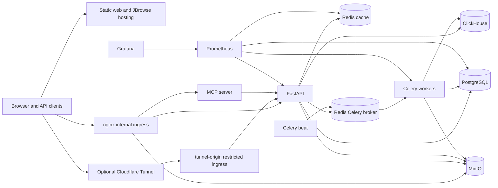
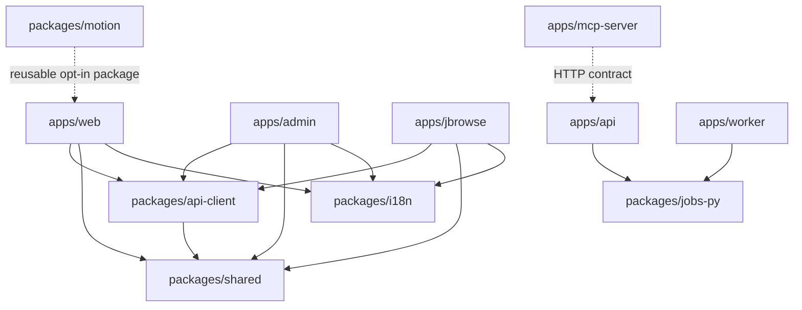
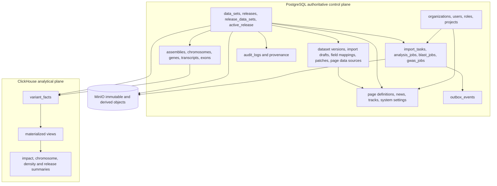
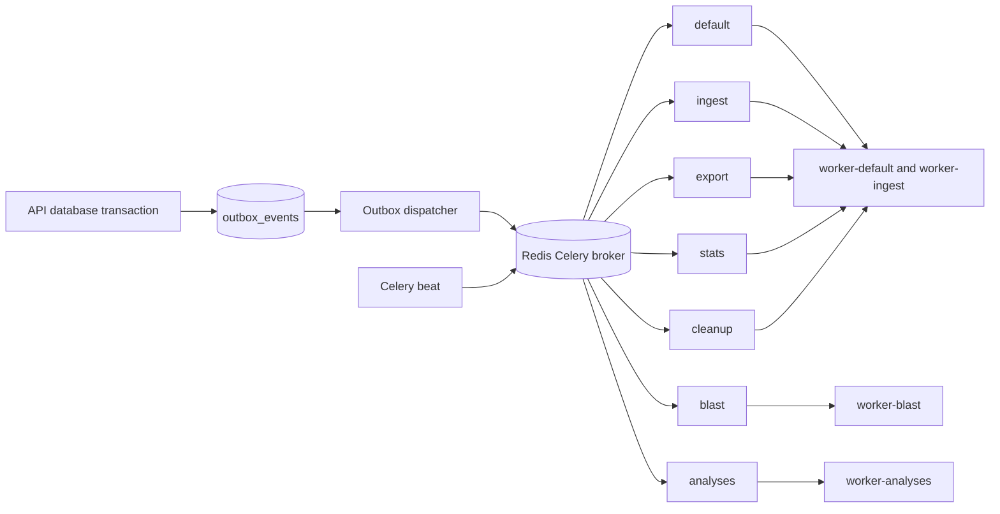
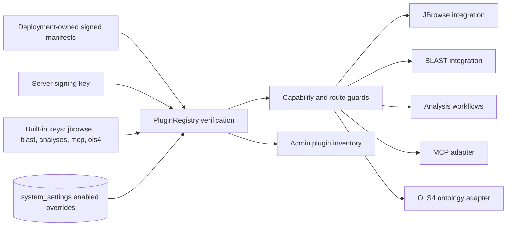

# Dependency and runtime maps

These diagrams are the human-readable architecture view. They intentionally
show stable ownership and data flow rather than every transitive library. The
machine graphs generated by CI are the exhaustive, normalized evidence for the
resolved pnpm, uv, Compose, and OCI inputs.

Sources of truth:

| View | Authoritative inputs |
| --- | --- |
| Services | `docker-compose.yml`, `.github/workflows/ci.yml` |
| TypeScript packages | `pnpm-workspace.yaml`, `pnpm-lock.yaml`, workspace `package.json` files |
| Python packages | `apps/api/uv.lock`, `apps/worker/uv.lock`, `apps/mcp-server/uv.lock` |
| Databases | `apps/api/app/models/`, API migrations, ClickHouse migrations |
| Queues | `packages/jobs-py/src/soymutdb_jobs/contract.py`, worker routing, Compose worker commands |
| Plugins | `apps/api/app/core/plugins.py`, signed deployment manifests, system-setting overrides |

## Service topology



The Cloudflare route is deliberately narrower than internal nginx: it does not
publish the admin API, MCP, databases, object-store console, or monitoring.

## Workspace package topology



Solid arrows are declared workspace dependencies. The MCP connection is a
runtime HTTP contract, not a Python import. `packages/jobs-py` is the shared
task-name, queue, payload, and state contract that prevents the API from
importing worker implementation code. `packages/ui` is retained as a
read-only compatibility debt during this migration: Web, Admin, and JBrowse
no longer import it, but the package and its transitive Radix/CVA entries
remain in the lockfile until a reviewed cleanup removes them.
`packages/i18n` pins the same React 19.2.0 and react-dom 19.2.0 runtime as
the applications so `initReactI18next` registers on one shared i18next
instance; a second peer-resolved copy previously made every `useTranslation`
return raw keys in the browser.

## Database topology



PostgreSQL owns identity, workflow state, publication pointers, and audit
facts. ClickHouse is a release-keyed analytical projection. MinIO carries raw,
published, analysis, and provenance objects; it is not a substitute for the
relational state machine.

## Queue topology



The shared queue names are declared in
`packages/jobs-py/src/soymutdb_jobs/contract.py`. Worker routing and Compose
consumer lists must agree with that contract; an unrouted task falls back to
`default` explicitly.

## Plugin topology



Plugins are server-owned integration capabilities, not uploaded executable
code. The registry rejects unsigned, unknown, duplicate, incompatible, or
unhealthy manifests before a capability becomes available. Administrative
state changes only persist an enabled override for a verified manifest.

The read-only OLS4 adapter is a registered signed deployment plugin. Its
canonical manifest declares only the bounded read routes
(`/ontology/search`, `/ontology/term`, `/ontology/graph`), and the public
routes fail closed unless a verified OLS4 manifest is installed and enabled.
`/ontology/graph` projects the official one-hop OLS4 graph into at most 50
nodes and 100 referentially closed edges. The web Page Builder maps its
`ontology_relationship_graph` renderer to the same capability and dynamically
loads Cytoscape only after bounded graph data is available.

## Machine evidence and gate semantics

CI runs `pnpm deps:graphs` and uploads these normalized JSON files:

- `pnpm.json`: workspace importers plus resolved lockfile dependency edges;
- `uv.json`: API, worker, and MCP lockfile nodes and conditional edges;
- `compose.json`: services, `depends_on`, networks, volumes, profiles, images;
- `oci.json`: release images, Dockerfile `FROM`/`COPY --from` edges, target platforms;
- `manifest.json`: per-file SHA-256, source revision, and aggregate status.

CI separately runs the policy in `dependency-governance.json`. Each Knip,
Deptry, duplicate-version, circular-dependency, license, and vulnerability
check writes its report plus a row in `summary.json`. A missing executable is
recorded as `unavailable`; a nonzero analyzer is `failed`; a zero exit without
the declared valid report is also `failed`. The job succeeds only when every
row is `passed`. An uploaded artifact is therefore evidence, not evidence that
an unavailable analyzer passed.

## 8. License checks are a projection, not a string comparison

The three `python-licenses-*` gates are the one place where the analyzer's own
verdict is not the authority. pip-licenses compares the raw `License` field
against the allow-list, and that comparison cannot see a PEP 639
`License-Expression` -- the field modern wheels actually publish -- nor an
expression such as `Apache-2.0 AND MIT`. On the pinned interpreter
(python:3.14 / pip-licenses 5.0.0) it reports 31 of the 85 API packages as
`UNKNOWN`, every one of them because its metadata carries only
`License-Expression: MIT` and no legacy `License:` or license classifier:

```
license UNKNOWN not in allow-only licenses was found for package fastapi:0.137.1
```

So each check declares `"normalize": "license-expressions"` and an
`"allow_file"`, and `scripts/dependency_governance.py` re-applies the policy to
the analyzer's JSON report:

* `pip-licenses --from=mixed` makes the analyzer read the authoritative
  `License-Expression` when a package declares one;
* `license_grant_alternatives()` projects the value into alternatives -- `;` and
  `OR` are choices, `AND` requires all of its options, and `WITH` is an
  exception that binds to its right operand;
* a package is flagged only when **no** alternative is acceptable in full, so
  `MIT OR GPL-3.0-only` grants a choice and passes while
  `MIT AND GPL-3.0-only` does not;
* the allow-list itself lives in `dependency-licenses.json` so the three
  projections cannot drift apart, and free text is never guessed: a package
  that declares neither a `License-Expression` nor a recognised classifier
  stays `UNKNOWN` and keeps failing closed.

The normalized result is recorded per check in `summary.json` (`findings`) and
in `<check>.findings.log`, so the artifact explains a failure by package.
