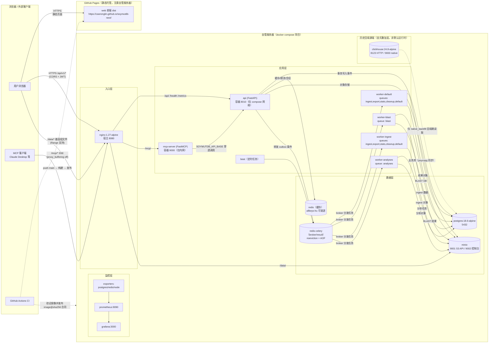

# SoyMutDB 部署架构

> **历史文档：非当前主路径。** 当前规范见 [开发者架构与部署](../dev/architecture-and-deployment.md) 和
> [运维数据发布手册](../ops/data-import-and-release.md)。本文仅保留现状审计与迁移背景。

> **ClickHouse 状态（2026-10-14 复核）**：默认栈不含 ClickHouse。`docker-compose.yml`、
> `docker-compose.dev.yml`、`docker-compose.local.yml`、`docker-compose.preview.yml` 都没有
> `clickhouse` / `migrate-clickhouse` 服务，API/Worker 也不再注入 `SOYMUTDB_CLICKHOUSE_*`
> 或依赖它。历史源端与旧 schema migrator 只存在于
> `docker-compose.legacy-clickhouse.yml`，必须显式加载并选择 `legacy-migration` profile。
> 本文出现的 ClickHouse 内容因此分成两类：默认运行时事实，和明确标注的历史遗留引用。
> 迁移状态与验收见 [原生 PostgreSQL 迁移与验收](../dev/native-postgres-cutover.md)。

> C6 交付物：梳理生产部署拓扑、访问入口、环境变量矩阵与故障排查。
> 原始盘点为 2026-08（分支 `feature/upgrade-antd-mcp-mcp`），2026-10-14 按原生 PostgreSQL
> 架构复核并订正了 ClickHouse、备份恢复与 Pages 发布相关描述。
> 本文档**只描述现状**（docker-compose*.yml / infra/nginx / .github/workflows 的实际行为），不改变任何配置。
>
> **注（2026-10-18）**：文中出现的 `apps/web/vite.config.ts` / `apps/web/index.html` 是 Umi 迁移前的路径；当前 `base` 由 `apps/web/scripts/build-sites.ts` 的 `SOYMUTDB_*_BASE_URL` 与 `apps/web/config/config.ts` 决定，CSP/CF beacon 由 `packages/shared/src/deployment.ts` + `apps/web/scripts/finalize-csp.ts`/`config.ts` 实现。
> 与配置不符之处见文末「遗留项与现状不符点」。

---

## 1. 部署总览（决策记录）

| 面 | 方案 | 状态 |
| --- | --- | --- |
| 后端 + 数据面 | docker compose（api / worker×4 / beat / postgres / redis×2 / minio / mcp-server / nginx / alertmanager / prometheus / grafana / exporters） | ✅ 主路径，systemd 编排 compose 项目 |
| 历史回填源端 | `docker-compose.legacy-clickhouse.yml` 叠加层（clickhouse / migrate-clickhouse），仅 `legacy-migration` profile | ⏸ 历史显式路径，不属于默认运行时 |
| 后端 + 数据面（备选） | **conda 裸进程**（api / worker×4 / beat）+ 数据层可仍由 docker compose 提供（推荐组合：docker 起数据层，conda 跑应用层） | ✅ 备选（D6 重新启用），见 `deploy/conda/README.md`，一键脚本 `deploy/scripts/conda-deploy.sh` |
| 前端静态托管（demo） | **GitHub Pages（gh-pages 分支）**，`CI 在 main 上成功（workflow_run）→ pages.yml 校验并搬运已验证产物` | ✅ 已上线 https://caoronglin.github.io/soymutdb-next/ |
| 前端静态托管（可选生产） | Cloudflare Pages（web / JBrowse；管理端需独立受保护 origin） | ✅ 受支持，见 `deploy/cloudflare.md` |
| API 边缘入口（可选生产） | Cloudflare Tunnel → `cloudflared` → `tunnel-origin` | ✅ `cloudflare-tunnel` profile；仅公开 API/基因组数据 |
| 旧部署链路 | Windows 服务 | ⛔ 已废弃（非主路径），`deploy/linux/install.sh` 已有标注 |

**关键约束（compose 内已固化，运维需知晓）：**

- 所有传给 api/worker/beat/migrate 的变量使用 `SOYMUTDB_` 前缀，字段与 `apps/api/app/core/config.py` 的 pydantic-settings 对齐；`APP_ENV` 仅 `dev|staging|prod`，生产用 `prod`。
- 应用镜像必须注入 `API_IMAGE_REF` / `WORKER_IMAGE_REF` / `MIGRATE_IMAGE_REF` / `MCP_IMAGE_REF` / `JBROWSE_IMAGE_REF`，且值为 CI 发布合同中的 `image@sha256`；tag 不能作为生产回退。本地构建必须走 `scripts/compose-local.sh`（同一批 Dockerfile），它是显式的开发/自建入口，不是发布路径的回退。`MIGRATE_CLICKHOUSE_IMAGE_REF` 只在历史叠加层场景需要（见 §4.1-A）。
- 一次性迁移由 `migrate` 服务负责（alembic upgrade head）；api/worker 依赖其 `service_completed_successfully` 才启动。迁移服务有自己的镜像，不复用 API/Worker 引用——否则「只更新 digest 的发布」会跑上一个 release 的迁移。
- 迁移成功之后、启动服务之前，`upgrade.sh` 执行 `app.scripts.verify_native_cutover`：已知含变异的公开版本必须有可核对的原生事实计数，以及回填凭据或原生 published import。不通过就不启动新应用。
- 旧 ClickHouse schema 迁移（`migrate-clickhouse`）已移出默认路径：`upgrade.sh` 不再引用它，只有显式加载历史叠加层并使用 `legacy-migration` profile 时才会运行。
- 前端静态站点以 Pages 为主；可选 `jbrowse` profile 提供 loopback 自托管 JBrowse。nginx 仍仅反代 API / MinIO / MCP，既有 `web/admin/jbrowse` 占位上游不自动切换到可选容器。
- `cloudflare-tunnel` 是可选 profile：`cloudflared` 不接入默认业务网络，只能经 `tunnel-origin` 到达 API 与公开 MinIO bucket；管理 API、MCP、监控与数据存储均不暴露。
- 数据存储镜像全部固定版本（无 `:latest`）。
- PostgreSQL 镜像 pin 为 `postgres:18.6-alpine`（compose / preview / `with-postgres-service.sh` /
  testcontainers 基线一致）。升级路径是 **18.4 → 18.6**：官方 `library/postgres` **没有 18.5 标签**
  （查询 `name=18.5` 返回 0 个结果），所以这不是一次单步小版本升级，评审与回滚都要按跨版本对待。
  本文只记录 pin 已更新，**不表示镜像已构建、已扫描或已在任何环境切换**。

---

## 2. 架构拓扑图



**依赖链速记（compose `depends_on`）：**

```
migrate ──► postgres(healthy)
api     ──► postgres + redis + redis-celery + minio(均 healthy) + migrate(completed)
worker* ──► postgres + redis-celery + minio(healthy) + migrate(completed)
beat    ──► redis-celery(healthy) + migrate(completed)
mcp-server ──► api(healthy)
nginx   ──► api(healthy)
minio-init ──► minio(healthy)（一次性建 6 个 bucket + genomic-data 公开策略）

历史叠加层（显式加载 + legacy-migration profile 才存在）：
clickhouse 自带 healthcheck；migrate-clickhouse ──► clickhouse(healthy)
```

**队列契约（七队列，compose 已固化）：**

| Worker | 队列 | 并发 | max-tasks-per-child |
| --- | --- | --- | --- |
| worker-default | ingest, export, stats, cleanup, default | 4（可调） | 100 |
| worker-ingest | ingest, export, stats, cleanup, default | 2（可调） | 20 |
| worker-blast | blast（独占，CPU 密集隔离） | 2（可调） | 50 |
| worker-analyses | analyses（独占，分析任务隔离） | 2（可调） | 20 |

---

## 3. 访问入口矩阵

> 宿主 `<HOST>` = 自管服务器 IP/域名。除注明外均需在服务器防火墙放行。

| 服务 | URL / 端口 | 认证 | 部署方式 | 备注 |
| --- | --- | --- | --- | --- |
| 门户网站（前端） | https://caoronglin.github.io/soymutdb-next/ | 公开 | GitHub Pages（gh-pages 分支） | API 调用走 `VITE_API_BASE_URL`（构建期注入） |
| API（经 nginx） | `http://<HOST>:8080/api/v1/*` | JWT（Bearer） | compose：nginx → api | 生产前端 CORS 白名单需含 gh-pages origin |
| API（容器内直连，排障） | `docker compose exec api curl http://localhost:8010/api/v1/health/ready` | JWT | compose：api | api 仅 expose 8010；宿主与公网入口均经 nginx:8080 |
| MCP Server | `http://<HOST>:8080/mcp/*`（SSE） | Bearer `SOYMUTDB_MCP_API_TOKEN` | compose：nginx → mcp-server | 60/min 限流占位（G3 门禁未接）；**nginx 必须 `proxy_buffering off`** |
| 基因组数据文件 | `http://<HOST>:8080/data/*` | 公开（genomic-data bucket） | compose：nginx → minio | 支持 Range（BAM/CRAM/tabix） |
| MinIO S3 API | `http://<HOST>:9001` | `MINIO_ROOT_USER` / `MINIO_ROOT_PASSWORD` | compose | 宿主 9001 → 容器 9000 |
| MinIO 控制台 | `http://<HOST>:9002` | 同上 | compose | 宿主 9002 → 容器 9001 |
| Grafana | `http://<HOST>:3000` | `GRAFANA_USER` / `GRAFANA_PASSWORD` | compose | 注册已禁用 |
| Prometheus | `http://<HOST>:9090` | 无（勿暴露公网） | compose | 30 天保留；`/-/reload` 支持 |
| PostgreSQL | `localhost:5432`（宿主） | `POSTGRES_PASSWORD` | compose | 唯一权威数据库；勿暴露公网 |
| Redis 缓存 | `localhost:6379` | `REDIS_PASSWORD` | compose | allkeys-lru；勿暴露公网 |
| redis-celery | `localhost:6380`（仅宿主回环） | `REDIS_PASSWORD` | compose | noeviction；供 conda 混合部署连接 |
| 管理端（web 模式） | `http://<HOST>:8080/admin/*` | 内网 IP ACL（RFC1918）+ JWT | compose nginx（上游已移除） | **当前返回 502/504 属预期**；前端迁移到 gh-pages 后此入口不再承担静态托管 |
| JBrowse | `http://<HOST>:8080/browser/*` | 公开 | 同上 | 同上（容器已移除） |
| 站点静态资源 `/` `/samples/` | `http://<HOST>:8080/` | — | 同上 | 同上，当前 502/504 |

> **502 说明**：compose 中 `extra_hosts` 将 `web/admin/jbrowse` 钉到 127.0.0.1，nginx 相关 location 启动不失败但请求返回 502/504——这是「前端移出 compose」后的既定占位行为，不是故障。

**历史遗留入口（不在默认栈内）**：ClickHouse 源端（`127.0.0.1:8123` HTTP / `9000` native，
凭据 `CLICKHOUSE_PASSWORD`）只在显式加载 `docker-compose.legacy-clickhouse.yml` 并选择
`legacy-migration` profile 时才监听，端口绑定回环地址，默认栈不发布它。

---

## 4. 环境变量矩阵

### 4.1 项目变量（compose 读取，模板 `deploy/.env.example` → 服务器 `/opt/soymutdb/.env`）

#### A. OCI 镜像 digest 引用（必填）

| 变量 | 示例 | 说明 |
| --- | --- | --- |
| `API_IMAGE_REF` | `ghcr.io/soymutdb/api@sha256:<64-hex>` | api；非 digest 时 upgrade 拒绝 |
| `WORKER_IMAGE_REF` | `ghcr.io/soymutdb/worker@sha256:<64-hex>` | 全部 worker / beat |
| `MIGRATE_IMAGE_REF` | `ghcr.io/soymutdb/migrate@sha256:<64-hex>` | 一次性 alembic 迁移 |
| `MCP_IMAGE_REF` | `ghcr.io/soymutdb/mcp-server@sha256:<64-hex>` | MCP adapter |
| `JBROWSE_IMAGE_REF` | `ghcr.io/soymutdb/jbrowse@sha256:<64-hex>` | 可选 `jbrowse` profile |
| `MIGRATE_CLICKHOUSE_IMAGE_REF` | `ghcr.io/soymutdb/migrate-clickhouse@sha256:<64-hex>` | **历史遗留，仅显式路径**：`upgrade.sh` 不再引用它，只有加载历史叠加层回填时才需要 |
| `COMPOSE_PROFILES` | `core,blast,analyses,mcp` | 默认生产能力；JBrowse/Tunnel 显式追加 |

默认运行时依赖的应用镜像族就是上面五个（api / worker / migrate / mcp / jbrowse）。
`scripts/list-images.sh` 仍保留 `migrate-clickhouse` 条目供历史叠加层使用；
`web` / `admin` 以静态产物发布，对应 Dockerfile 只服务于自建 compose profile。

#### B. 数据存储凭据（生产必须修改，`upgrade.sh` 预检会拦截默认值）

| 变量 | 默认（危险值） | 说明 |
| --- | --- | --- |
| `POSTGRES_PASSWORD` | `soymutdb_dev_password` | postgres 与 app 的 DATABASE_URL 同源 |
| `CLICKHOUSE_PASSWORD` | `soymutdb_dev_password` | **历史遗留，可选**：仅历史源端/回填需要，默认栈不消费 |
| `REDIS_PASSWORD` | `soymutdb_dev_password` | **redis 与 redis-celery 两个实例共用** |
| `MINIO_ROOT_USER` | `minioadmin` | 预检要求非默认值 |
| `MINIO_ROOT_PASSWORD` | `minioadmin` | 预检要求非默认值 |

#### C. Redis 职责隔离与内存（可选调优）

| 变量 | 默认 | 说明 |
| --- | --- | --- |
| `REDIS_CACHE_MAXMEMORY` | `512mb` | 缓存实例上限，超限驱逐（allkeys-lru） |
| `REDIS_CELERY_MAXMEMORY` | `512mb` | broker 实例上限，超限**报 OOM 拒绝写入**（noeviction） |
| `SOYMUTDB_CELERY_RESULT_EXPIRES` | `604800` | Celery result TTL（秒），建议 1–7 天 |

#### D. PostgreSQL 连接预算（调大需同步调大 PG `max_connections`，默认 100、应用预算 ≤ 80）

| 变量 | 默认 | 适用 |
| --- | --- | --- |
| `SOYMUTDB_DB_POOL_SIZE` / `SOYMUTDB_DB_MAX_OVERFLOW` | 5 / 5 | API（每 worker 进程） |
| `SOYMUTDB_DB_POOL_TIMEOUT` / `SOYMUTDB_DB_POOL_RECYCLE` / `SOYMUTDB_DB_POOL_PRE_PING` | 30 / 1800 / true | API |
| `SOYMUTDB_WORKER_DB_POOL_SIZE` / `SOYMUTDB_WORKER_DB_MAX_OVERFLOW` | 2 / 4 | 每个 worker 进程（API 忽略） |

#### E. API 生产必填（`config.py` prod fail-fast：缺失/示例值直接拒绝启动）

| 变量 | 要求 | 说明 |
| --- | --- | --- |
| `SOYMUTDB_JWT_SECRET` | ≥ 32 字符，禁止示例值 | JWT 签名密钥 |
| `SOYMUTDB_CORS_ORIGINS` | 逗号分隔精确 origin，**不含 `*`** | 带凭据 CORS；须含 gh-pages 前端 origin（如 `https://caoronglin.github.io`） |

#### F. 队列并发（可选调优）

| 变量 | 默认 | 说明 |
| --- | --- | --- |
| `WORKER_DEFAULT_CONCURRENCY` | 4 | worker-default |
| `WORKER_INGESTION_CONCURRENCY` | 2 | worker-ingest |
| `WORKER_BLAST_CONCURRENCY` | 2 | worker-blast |
| `WORKER_ANALYSES_CONCURRENCY` | 2 | worker-analyses |

#### G. 监控（可选）

| 变量 | 默认 | 说明 |
| --- | --- | --- |
| `GRAFANA_USER` / `GRAFANA_PASSWORD` | admin / admin | 必须修改 |

#### H. 发布脚本（可选，`deploy/scripts/upgrade.sh` 与 `healthcheck.sh`）

| 变量 | 默认 | 说明 |
| --- | --- | --- |
| `READY_RETRIES` | 60 | readiness 轮询次数（×5s = 300s 上限） |
| `API_HOST` / `API_PORT` | localhost / 8080 | readiness 与 healthcheck 目标（经 nginx） |
| `SOYMUTDB_INSTALL_DIR` | `/opt/soymutdb` | compose 项目定位（install.sh 布局） |
| `NGINX_HOST` / `NGINX_PORT` | localhost / 8080 | healthcheck 的 nginx 探针 |

### 4.2 compose 内部固定值（`x-app-env`，一般不需要改）

> 由 compose 写死（`${VAR:-default}` 形式可覆盖，但改错会导致服务间连不上）：

`SOYMUTDB_APP_ENV=prod`、`SOYMUTDB_REDIS_URL`（缓存实例）、`SOYMUTDB_CELERY_BROKER_URL` / `SOYMUTDB_CELERY_RESULT_BACKEND`（redis-celery 实例，DB 0/1）、`SOYMUTDB_S3_ENDPOINT=http://minio:9000`、`SOYMUTDB_S3_ACCESS_KEY/SECRET_KEY`、六个 `SOYMUTDB_S3_*_BUCKET`、`SOYMUTDB_DATABASE_URL`（api 用 asyncpg、worker 用 psycopg，host 均 `postgres`）。

`SOYMUTDB_CLICKHOUSE_HOST/PORT/USER/PASSWORD/DATABASE` **不再出现在默认 compose**，
只由 `docker-compose.legacy-clickhouse.yml` 的 `x-legacy-clickhouse-env` 注入历史服务。

### 4.3 MCP Server（`mcp-server` 服务）

| 变量 | 说明 |
| --- | --- |
| `SOYMUTDB_API_BASE` | 固定 `http://api:8010`（容器内），穿透调用内部 REST |
| `SOYMUTDB_MCP_API_TOKEN` | 写工具 Bearer 透传鉴权；为空则写工具无鉴权占位（G3 未接） |

### 4.4 前端构建期变量（打进产物；禁止放 secret）

> 生产构建由页面制品脚本完成：`VITE_API_BASE_URL` 取自部署配置。CDN 构建开关已随 ECharts/GSAP 退役删除；第三方库全部本地打包。
>
> 历史变量名沿用 `VITE_*`（构建已迁移到 Umi Max，前缀不再代表构建器）。新增变量使用 `SOYMUTDB_*`，见 [ADR-0016](../adr/0016-build-time-public-config-prefix.md)。

| 变量 | gh-pages 生产值 | 说明 |
| --- | --- | --- |
| `VITE_API_BASE_URL` | `https://…`（secret `API_BASE_URL`） | API origin，必须命中后端 `SOYMUTDB_CORS_ORIGINS` 白名单；未设置则用编译内默认值 |
| `VITE_JBROWSE_URL` | 部署的 JBrowse origin | `/browse` iframe 地址 |
| `VITE_JBROWSE_BASE_URL` | JBrowse standalone base | 见根 `.env.example` |
| `VITE_DEFAULT_ASSEMBLY` | `Wm82v4.0` | 默认基因组 |
| ~~`VITE_GSAP_CDN` / `VITE_ECHARTS_CDN` / `VITE_LENIS_CDN`~~ | — | 已随 ECharts/GSAP 退役删除；不要恢复 |
| `VITE_DEMO_MODE` | `false` | analytics 演示模式开关（可选） |
| `VITE_PUBLIC_URL` | — | admin 新闻预览（可选） |
| `SOYMUTDB_CLOUDFLARE_ANALYTICS_TOKEN` | token 值（可选） | Cloudflare Web Analytics beacon；旧名 `VITE_CLOUDFLARE_ANALYTICS_TOKEN` 仍兼容（见 4.5） |

### 4.5 Cloudflare Web Analytics beacon token

已实现。门户（`apps/web`）构建时读取
`SOYMUTDB_CLOUDFLARE_ANALYTICS_TOKEN`（旧名 `VITE_CLOUDFLARE_ANALYTICS_TOKEN`
仍兼容），由 `apps/web/config/config.ts` 的 `headScripts` 注入
`https://static.cloudflareinsights.com/beacon.min.js`，并由
`apps/web/scripts/csp.ts` 同步放宽 CSP。未设置 token 时产物与启用前一致。

- 该 token 属于**公开**值（会打进产物），不是 secret；可作为 CI 普通变量。
- 后台「访问设置 → 分析设置」页面只文档化 `SOYMUTDB_*` 新名、不保存 token，
  也不回读 Cloudflare；旧名仅记录在部署文档中。
- 运维步骤与验证方法见 `deploy/cloudflare.md` §5.5 / §6.5。

### 4.6 备份/恢复脚本环境变量（`deploy/scripts/backup.sh` / `restore.sh`）

| 变量 | 默认 | 说明 |
| --- | --- | --- |
| `BAK_BASE_DIR` | `/opt/soymutdb/backups` | 本地备份根目录 |
| `BACKUP_S3` | 空（仅本地） | 异地备份目标 `<alias>/<bucket>/<prefix>` |
| `BACKUP_S3_ENDPOINT` / `BACKUP_S3_ACCESS_KEY` / `BACKUP_S3_SECRET_KEY` | — | 异地 S3 凭据（可选） |
| `BAK_S3_BUCKETS` | `genomic-data user-tracks blast-dbs exports` | 需备份对象数据 |
| `BAK_RETAIN_DAILY/WEEKLY/MONTHLY` | 7 / 4 / 6 | 滚动保留 |
| `BAK_S3_HASH_OBJECTS` | 1 | 对象 SHA-256 清单（大对象可关） |
| `TARGET` | 空（拒绝执行） | restore 目标门槛；演练 `drill`，生产 `prod` 需二次确认 |

---

## 5. 新服务器从零部署步骤

> 以 Ubuntu/Debian 为例；全部命令可在服务器直接复制执行。

```bash
# 1) 安装 Docker Engine + compose 插件（官方源）
curl -fsSL https://get.docker.com | sudo sh
sudo systemctl enable --now docker
docker compose version   # 需输出 version，若缺插件：sudo apt install docker-compose-plugin

# 2) 克隆仓库并进入
git clone <repo-url> /opt/soymutdb-src
cd /opt/soymutdb-src
git checkout <release-tag-or-branch>

# 3) 安装（创建 soymutdb 系统用户、/opt/soymutdb 目录结构、复制 .env 模板）
sudo bash deploy/linux/install.sh

# 4) 填写生产环境变量（必改：镜像 digest refs、全部凭据、JWT、CORS、Grafana）
sudo vi /opt/soymutdb/.env     # 模板来自 deploy/.env.example

# 5) 生成 JWT secret（≥32 字符）
openssl rand -base64 48        # 复制输出到 SOYMUTDB_JWT_SECRET

# 6) 发布（预检 → 拉镜像 → 备份 → 迁移 → 原生切换门禁 → 启动 → readiness → smoke）
sudo bash deploy/scripts/upgrade.sh
# 首次部署无运行容器会跳过备份；后续每次发布前自动备份（backup.sh）

# 7) 健康检查（全部 critical 通过、退出码 0）
bash deploy/scripts/healthcheck.sh
```

**镜像引用获取**：CI 在原生 amd64/arm64 runner 分别完成 runtime smoke、阻断式 Trivy 与 SPDX 后，发布 job 才加载两份已校验镜像包并合并 manifest。最终 index、平台 digest、SBOM、SLSA provenance 与 `release-manifest.json` 使用 GitHub OIDC/Cosign 签名并立即验证；workflow artifact 和 summary 给出四个最终 `image@sha256` 与合同 SHA-256。将最终 index 引用写入 `/opt/soymutdb/.env`，不要复制发现 tag 或架构临时 tag。blue/green 由 [外部 slot adapter 合同](../../deploy/blue-green.md)执行，当前固定端口 Compose 不宣称同机双槽。

**迁移与门禁说明**：`upgrade.sh` 执行一次性迁移（`docker compose run --rm migrate`，alembic upgrade head）；api/worker 自身 `depends_on` 也强制 migrate 成功。紧接着在启动服务之前运行
`docker compose run --rm --no-deps migrate python -m app.scripts.verify_native_cutover`：
已发布且含变异的版本必须能在原生表里数出与可信计数一致的变异，并且有回填凭据或原生
published import。门禁失败时服务不会被启动，发布中止。迁移失败同样中止发布并回滚镜像。

**防火墙放行清单**（按需，勿全开）：`8080`（nginx 唯一对外入口，公网）、`8010`（API 直连，仅内网）、`9002`（MinIO 控制台，内网/运维 VPN）、`3000`（Grafana，内网）、`9090`（Prometheus，内网）。`5432/6379` 一律仅 localhost；历史 ClickHouse 的 `8123/9000` 同样只在加载历史叠加层时绑定回环地址。

**历史回填路径（显式，不在默认发布流程内）**：回填前由运维显式加载
`docker-compose.legacy-clickhouse.yml` 并选择 `legacy-migration` profile，起历史源端与旧
schema migrator；应用侧的 `soymutdb_worker.native_backfill` 需显式提供目标 PostgreSQL 与
历史源连接信息，默认只读预演。回填尚未在真实历史全量数据上执行，详见
[原生 PostgreSQL 迁移与验收](../dev/native-postgres-cutover.md)。

---

## 6. 前端发布流程（GitHub Pages）

```
CI 在本仓库 main 上成功（workflow_run 触发）
   │
   ▼
.github/workflows/pages.yml（仅此文件负责 gh-pages；是 .cnb.yml 的镜像，不自带构建逻辑）
   ├─ gate：workflow_run 仅接受本仓库 main 分支的成功 CI；非 main / 外部仓库 / 失败都在此拦截，deploy 被跳过
   ├─ checkout 触发 CI 的同一 commit（workflow_run.head_sha），确保发布经过验证的代码
   ├─ 下载 CI 产出的已验证 Pages 产物 pages-demo-dist（含 SHA256SUMS）
   ├─ bash scripts/verify-pages-artifact.sh /tmp/pages-dist（入口点、校验和覆盖、字节树一致）
   ├─ git checkout --orphan gh-pages → 复制这份已验证的字节
   ├─ 再做一次文件列表 diff 与 sha256sum -c，确认部署树与产物逐字节相同
   └─ git push origin gh-pages --force
           │
           ▼
GitHub Pages 站点刷新：https://caoronglin.github.io/soymutdb-next/
```

**要点：**

- 仓库 Settings → Pages → Source 选择 **gh-pages 分支 / root**（Pages source 已切换，见 commit `7c476f23f`）。
- 构建期的 `VITE_API_BASE_URL`（仓库 secret `API_BASE_URL`）在 CI 的构建脚本里注入，
  Pages workflow 只搬运已验证产物，不再自己执行 pnpm 构建。
- `.nojekyll` 与 SPA 兜底由构建产物自带，Pages workflow 不再单独拼装 `404.html`。
- 该 workflow 没有 `workflow_dispatch`：手动投喂任意产物被刻意禁止，每个 Pages 字节都保留 CI 出处。
- 前端与后端解耦：gh-pages 只承载静态产物，所有动态请求回源 nginx 的 `/api/v1/*`。

---

## 7. 常见故障排查表

| # | 症状 | 根因（本项目已知） | 排查/处置命令 |
| --- | --- | --- | --- |
| 1 | `api` 容器反复重启（Restarting） | prod fail-fast：`SOYMUTDB_JWT_SECRET` 缺失/短于 32 字符、CORS 缺失、凭据仍为 dev 默认值 → `config.py validate_security_configuration` 抛 ValueError | `docker compose logs api --tail 100`；对照 §4.1-E 检查 `/opt/soymutdb/.env`；`docker compose config -q` 先验证 |
| 2 | 服务卡在启动不健康 | `depends_on` 链：migrate 未完成 / 数据存储未 healthy；migrate 也走 prod 校验（缺 JWT 时 migrate 同样拒绝） | `docker compose ps`、`docker compose events`；先看 `migrate` 退出码：`docker compose logs migrate` |
| 3 | worker 健康检查失败（unhealthy） | healthcheck 用 `celery inspect ping -d worker-default@$$HOSTNAME`：broker URL 错指缓存 redis（allkeys-lru）或密码不匹配时 worker 注册失败/心跳丢失 | `docker compose exec worker-default celery -A soymutdb_worker.main:celery_app inspect ping`；确认 `SOYMUTDB_CELERY_BROKER_URL` 指向 `redis-celery:6379/0` |
| 4 | 任务不进队列（API 正常但无任务） | ① outbox 表行 `failed`（`outbox_max_attempts=5` 用尽）——dispatcher 每 1s 轮询转发；② 消息被路由到 `analyses` 等无 worker 的队列；③ redis-celery 超内存被 noeviction 拒绝写入 | `docker compose exec postgres psql -U soymutdb -d soymutdb -c "select * from outbox order by id desc limit 10;"`；`docker compose exec redis-celery redis-cli -a $REDIS_PASSWORD xlen celery`；检查 `docker compose logs worker-default` |
| 5 | MCP SSE 断流/消息截断 | nginx 代理 SSE 必须 `proxy_buffering off`（`/mcp/` 已配置）；长连接 600s read timeout 后需客户端重连；mcp-server 依赖 api healthy，API 重启会断开现有流 | `curl -N http://<HOST>:8080/mcp/ -H "Accept: text/event-stream"` 观察流；检查 nginx 日志是否出现 buffering/upstream timeout；确认 `/mcp/` location 未被子级规则覆盖 |
| 6 | 请求被 429 限流误伤 | nginx limit_req：API 100r/s（burst 200）、BLAST 1r/s（burst 5）、auth 10r/s（burst 20）；爬虫/批量脚本/共享出口 IP 会触发 | 响应体为 `{"error":"rate_limit_exceeded",...}`（`@ratelimit`）；`docker compose exec nginx grep -c limit /var/log/nginx/*.log`；非 BLAST 请求确认没打 `/api/v1/blast/` |
| 7 | gh-pages 站点不更新 | ① CI 未通过（build/test/lint/typecheck/contract 等硬门禁失败 → workflow_run gate 拦截发布，Pages 运行显示 gate 失败）；② 旧产物缓存（Pages CDN 约 10 分钟）；③ CI 尚未跑完（发布在 CI 完成后才触发） | 仓库 Actions 查看 CI 与 Deploy Web to Pages 运行；本地 `curl -sI https://caoronglin.github.io/soymutdb-next/ | grep -i last-modified`；确认 `secrets.API_BASE_URL` 已设置（否则产物 API 地址错误） |
| 8 | 历史回填时 ClickHouse 容器起不来：ulimit/pids 报错 | **仅历史叠加层**：历史源端要求 `nofile=262144`（叠加层已设 ulimits）；宿主 `fs.file-max`/systemd 服务 LimitNOFILE 不足时容器启动即失败 | `docker compose -f docker-compose.yml -f docker-compose.legacy-clickhouse.yml --profile legacy-migration logs clickhouse`；`sysctl fs.file-max`、`ulimit -n`；宿主调大后 `systemctl daemon-reload && systemctl restart soymutdb.target` |
| 9 | 访问 `/`、`/admin/`、`/browser/` 得到 502/504 | **预期行为**：前端容器已移出 compose，nginx 上游 `web/admin/jbrowse` 由 extra_hosts 钉到 127.0.0.1 | 不用处理；前端走 gh-pages。仅当需要临时自托管时再恢复相应容器（属未来任务，勿改现有 compose 行为） |
| 10 | PostgreSQL 连接耗尽（`too many connections`） | pool 预算默认 40/100；调大 `SOYMUTDB_DB_POOL_SIZE` 等后未同步调大 PG `max_connections`；worker 并发瞬时重启尖峰 | `docker compose exec postgres psql -U soymutdb -d soymutdb -c "select count(*) from pg_stat_activity;"`；按 compose 头部注释预算调整，勿超 80 |
| 11 | redis-celery 写入失败（OOM command not allowed） | broker 实例 noeviction：内存到达 `REDIS_CELERY_MAXMEMORY`（默认 512mb）后拒绝写入，任务积压/丢失风险 | `docker compose exec redis-celery redis-cli -a $REDIS_PASSWORD info memory | grep -E "used_memory_human|maxmemory"`；调大内存上限并监控告警 |
| 12 | 恢复演练失败（verify-restore 非全 PASS） | 默认 v3 备份只含 PostgreSQL + S3；历史 v2 包含 ClickHouse 组件，必须加 `--allow-legacy-v2` 且目标 compose 显式提供 ClickHouse 服务，否则工具直接失败而不是把缺失组件当作已校验 | 检查 manifest 的 `format_version` 与 `components`；v2 回填演练用显式历史目标配置；演练环境用与生产**同版本镜像** |
| 13 | 发布在启动前被中止，日志里有 `native cutover verification failed` | `upgrade.sh` 的 `app.scripts.verify_native_cutover` 发现某个已发布含变异版本在原生表里数不出可信数量，或既无回填凭据也无原生 published import | `docker compose run --rm --no-deps migrate python -m app.scripts.verify_native_cutover` 看 `faults` 明细；确认该版本已完成逐版本回填与核验后再重发 |

---

## 8. 备份恢复速查

### 8.1 备份（`deploy/scripts/backup.sh`）

```
一次 run 完成权威备份（默认格式 v3，PostgreSQL 是唯一权威库）：
  [1] PostgreSQL   pg_dump (custom) + 每表行数快照
  [2] MinIO/S3     mc mirror 四 bucket + 每对象 SHA-256 清单 + bucket policy
  [3] manifest.json（format_version = 3，backup_id = 时间戳+短 sha）
  [4] <id>.tar.gz + .sha256
  [5] 可选 BACKUP_S3 异地上传
  [6] 滚动保留：7 日备 + 4 周备 + 6 月备（可配）
```

v3 不再备份 ClickHouse：默认运行时没有该组件，事实与关系都在 PostgreSQL 里。
包含 ClickHouse 组件的是历史 v2 包，只能显式恢复。

```bash
# 本地全量备份（默认 /opt/soymutdb/backups）
bash deploy/scripts/backup.sh

# 异地备份（在 /opt/soymutdb/.env 或环境变量配置 BACKUP_S3 后）
BACKUP_S3=backup-bkt/soymutdb/backups bash deploy/scripts/backup.sh
```

> Redis 不备份（设计如此）：缓存与 broker 均为易失/可重建状态；Job/Outbox 权威状态在 PostgreSQL，恢复后由应用重建。

### 8.2 恢复（`deploy/scripts/restore.sh`）

```bash
# 演练（隔离栈；必须显式给出 --target 与该目标的配置，缺一即拒绝执行）
bash deploy/scripts/restore.sh --target drill --target-config /secure/drill.env \
  /opt/soymutdb/backups/<id>.tar.gz

# 生产（覆盖 PG+S3，需输入 restore 二次确认；不接受 --target-config）
bash deploy/scripts/restore.sh --target prod /opt/soymutdb/backups/<id>.tar.gz

# 历史 v2 包：必须显式声明，并提供含 ClickHouse 服务的目标 compose
bash deploy/scripts/restore.sh --allow-legacy-v2 --target prod \
  /opt/soymutdb/backups/<legacy-v2-id>.tar.gz

# 校验（全部 PASS 且退出码 0 才视为成功）
bash deploy/scripts/verify-restore.sh /opt/soymutdb/backups/<id>.tar.gz
# 历史 v2 校验同样需要 --allow-legacy-v2 与可用的 ClickHouse 目标
bash deploy/scripts/verify-restore.sh --allow-legacy-v2 /opt/soymutdb/backups/<legacy-v2-id>.tar.gz
```

非生产目标还必须通过 `--target-config` 声明目标身份、隔离标记和 compose 文件，
且不允许复用默认生产 compose 文件。

历史 v2 路径还要求：目标 compose 旁存在 `docker-compose.legacy-clickhouse.yml`（或用
`RESTORE_LEGACY_COMPOSE_FILE` / `VERIFY_LEGACY_COMPOSE_FILE` 显式指定）、compose 中确有
`clickhouse` 服务，并提供 `RESTORE_CLICKHOUSE_HOST/USER`（校验侧为 `CLICKHOUSE_HOST`）。
组件缺失一律报错退出，绝不会被记成「已校验」。详见 `docs/ops/disaster-recovery.md`。

恢复顺序固定：PostgreSQL → S3（mc mirror --remove + 按 manifest 校验 SHA-256）；
历史 v2 才在两者之间插入 ClickHouse 的 RESTORE DATABASE。恢复后：
`sudo systemctl restart soymutdb.target`（生产）。

### 8.3 演练节奏（建议）

- **每月至少一次**：隔离主机/独立 compose 项目起同版本空栈 → `--target drill`（附目标配置）恢复 → `verify-restore.sh` 全 PASS。
- **每次发布**：`upgrade.sh` 自动在迁移前执行备份（首次部署无运行 postgres 时跳过）。
- **磁盘告警**：Prometheus 磁盘 >85% 告警依赖 node-exporter；备份目录增长纳入容量规划（`BAK_RETAIN_*` 控制）。

---

## 9. 遗留项与现状不符点（平台交付更新：R2/R3/R4 已完成；R1/R5/R6/R7 与 R8–R11 仍遗留）

| # | 项 | 状态 | 说明 |
| --- | --- | --- | --- |
| R1 | gh-pages 子路径 base | ⏳ 遗留 | 站点托管在 `https://caoronglin.github.io/soymutdb-next/`（子路径），但 `apps/web/vite.config.ts` 未配置 `base`；如子路径部署生效依赖相对资源路径/当前产物实际状态，需在发布流程中确认（本项目未改动）。若未来换自定义域名根路径托管，需同步调整。 |
| R2 | OCI 发布身份 | ✅ 静态合同已实现，外部运行待验 | amd64/arm64 原生 job 各自 build/smoke/Trivy/SPDX；`publish-images` 仅加载这两份包，合并精确平台集合并用 OIDC/Cosign 签名 index、SBOM、provenance 与 release manifest。生产只接受 digest refs；ARM runner、GHCR/Sigstore 和真实签名运行仍须 CI 证明。 |
| R3 | CF beacon token | ✅ 已实现（C3） | `apps/web/vite.config.ts` 的 `transformIndexHtml` 已在构建时按 `VITE_CF_WEB_ANALYTICS_TOKEN` 注入 `static.cloudflareinsights.com/beacon.min.js`；`index.html` 留有占位注释。**注意**：CSP（`index.html` meta 与部署 `_headers`）需在启用 token 时同步放行 `script-src https://static.cloudflareinsights.com` 与 `connect-src https://cloudflareinsights.com`。 |
| R4 | MCP 限流 | ✅ 已实现（G3） | `apps/mcp-server/src/mcp_server/ratelimit.py` 在传输层实现：全局 60 req/min/客户端 + `blast_submit` 10 次/hr；超限返回 `429 {"error":"rate_limited","retry_after":N}`；`SOYMUTDB_MCP_API_TOKEN` 通过 `Authorization: Bearer` 鉴权（server.py + manifest.py）。 |
| R5 | 历史文档过时 | ⏳ 遗留（部分跟进） | `deploy/cloudflare.md`（CF Pages 方案，已放弃）、`deploy/windows/` 为非主路径，仅做标注；`deploy/conda/` 已由 D6 重新启用为备选路径（见 `deploy/conda/README.md`）；`README.md` 顶部架构图仍描述 nginx 托管前端静态（旧三层隔离），未重写架构图。 |
| R6 | CORS 白名单待填 | ⏳ 遗留 | 生产 `SOYMUTDB_CORS_ORIGINS` 需包含 gh-pages origin（`https://caoronglin.github.io`）；`deploy/.env.example` 中为示例域名。 |
| R7 | healthcheck.sh 前端段 | ⏳ 遗留 | 脚本注释已改为 gh-pages 表述（仅注释），仍待发布流程实测确认。 |
| R8 | `deploy/.env.example` 过期注释 | ✅ 已修正 | 默认升级迁移 PostgreSQL 并校验事实完整性；历史 ClickHouse 迁移必须显式加载 overlay。 |
| R9 | `upgrade.sh` 头部步骤注释 | ✅ 已修正 | 步骤编号已统一，并注明迁移后 `verify_native_cutover` 失败时不启动应用。 |
| R10 | 历史回填的真实执行 | ⏳ 未开始 | 逐版本回填、旧源端清单核对、生产镜像切换都还没有真实执行记录；本文不对其做任何完成度声明。 |
| R11 | Python 3.15 全链路 | 🔶 配置已落定，运行待实测 | **已完成的只是配置**：`apps/api`、`apps/worker`、`apps/mcp-server`、`packages/jobs-py` 声明 `requires-python >=3.15`，`.cnb/env/Dockerfile.frontend` 与 api/migrate/worker 镜像基于 `python:3.15`，`.cnb.yml` 后端 stage 用 `python:3.15`。**未完成的是运行证据**：整套服务在 3.15 上的运行与镜像结果尚未实测；worker 全套最后一次完整运行仍在 Python 3.14，且有 7 个跳过项（本机缺 DIAMOND 可执行文件的外部程序测试，跳过不等于通过）。历史 `migrate-clickhouse` lane 刻意留在 3.14（`clickhouse-connect` 不发布 3.15 版本），这是设计决定不是缺口。三件事分开记，任何一件都不能推导出「生产切换已完成」。 |

---

## 相关文件索引

| 文件 | 作用 |
| --- | --- |
| `docker-compose.yml` | 生产栈全部服务定义（本拓扑的权威来源；不含 ClickHouse） |
| `docker-compose.legacy-clickhouse.yml` | 历史源端与旧 schema migrator，仅 `legacy-migration` profile 显式加载 |
| `scripts/compose-local.sh` | 本地构建并运行生产拓扑；默认不加载历史叠加层，`SOYMUTDB_LOCAL_LEGACY_CLICKHOUSE=1` 才加载并启用 `legacy-migration` |
| `scripts/test_native_compose_cutover_contracts.py` | 断言四个默认 compose 无 ClickHouse、历史叠加层隔离、升级门禁先于启动 |
| `infra/nginx/nginx.conf` + `infra/nginx/conf.d/default.conf` | 反代/限流/SSE/安全头 |
| `deploy/.env.example` | compose 项目变量模板（§4.1） |
| `.env.example`（仓库根） | 前端 VITE_* 模板（§4.4） |
| `deploy/linux/install.sh` / `deploy/linux/*.service` / `deploy/linux/soymutdb.target` | systemd 编排 compose 项目 |
| `deploy/scripts/upgrade.sh` / `backup.sh` / `restore.sh` / `verify-restore.sh` / `healthcheck.sh` | 发布/备份/恢复/健康检查 |
| `.github/workflows/pages.yml` | gh-pages 前端发布（§6） |
| `.github/workflows/ci.yml` | 构建门禁 + docker 镜像构建（R2） |
| `apps/api/app/core/config.py` | SOYMUTDB_* 字段权威定义与 prod fail-fast |
| `apps/api/app/scripts/verify_native_cutover.py` | 发布前的原生切换门禁逻辑 |
| `docs/dev/native-postgres-cutover.md` | 原生 PostgreSQL 迁移状态、门禁语义与验收记录 |
| `deploy/cloudflare.md` | 已放弃的 CF Pages 方案（非主路径，仅标注） |
