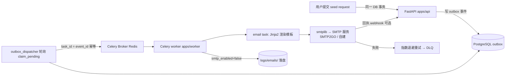

# SoyMutDB 需求整合与执行台账（2026-08）

> **已归档（2026-10-01）**：2026-08 设计波次与旧基线快照。继任：docs/aegis/baseline/2026-10-01-react-only-baseline.md；门户布局以 `docs/superpowers/specs/2026-08-14-public-web-layout-alignment-design.md` 为准。仅供历史审计，**不得作为现状引用**；归档清单见 [`docs/ARCHIVE.md`](../ARCHIVE.md)。

> 分支：`feature/upgrade-antd-mcp-mcp` ｜ 编制：D7（清理整理 + 文档整合）
> 范围：本轮 A 批（邮件/通知/整合）与 B 批（清理/conda/消息性能/SW/Admin 增强）需求统一整合；
> 已完成的调研结果（plyer / 知乎邮件文章 / MDN Service Worker / 相似项目）归档；
> 架构优化建议落为 backlog；遗留问题统一台账。
> 关联文档定位见 §7（本文件是**需求与执行状态**的权威入口，方案细节仍以各设计文档为准）。

---

## 1. 需求清单

### 1.1 A 批：邮件模块 / 通知 / 整合

| # | 需求 | 来源摘要 | 决策 | 负责人 | 状态 |
| --- | --- | --- | --- | --- | --- |
| A1 | 种子申请（seed request）邮件通知 | 用户要求种子申请提交后自动发确认邮件 | 采用**事务性 outbox + Celery worker + smtplib** 架构（§4）；Jinja2 模板渲染；SMTP opt-in（`smtp_enabled=false` 时写 `logs/emails/`，本地可验证） | D1–D6（api/worker） | ✅ 已完成：`seed_request_service.py`（outbox 入队）+ `apps/worker/.../tasks/email.py` + `templates/email/seed_request_confirm.html.j2` + `core/config.py` SMTP 配置 |
| A2 | 应用内通知体系 | 用户要求站内通知（区别于邮件） | 三通道通知体系（§5）：应用内（notification_service）+ 浏览器 Notification API（Web Push 预留）+ 桌面 plyer（桌面端） | D1–D6（api） | 🔶 执行中：`services/notification_service.py` 已建，浏览器/桌面通道为 backlog |
| A3 | 邮件方案与需求整合 | 用户要求把调研结果 + 新需求整合成统一文档 | 本文件；调研结论归档 §2–§3；邮件架构图 §4 | D7 | ✅ 本文件 |

### 1.2 B 批：清理 / conda / 消息性能 / Service Worker / Admin 增强

| # | 需求 | 来源摘要 | 决策 | 负责人 | 状态 |
| --- | --- | --- | --- | --- | --- |
| B1 | 项目清理（死依赖/死条目/基线错误） | 用户要求清理整理项目、处理遗留问题 | C1 遗留 react-syntax-highlighter 移除（§6-1）；eslint 豁免清单清理（§6-5）；typecheck 基线错误低成本修复（§6-4）；`.trash/` 等目录核对（§6-6） | D7 | ✅ 已完成（本批明细见 §6） |
| B2 | conda 环境 | 用户要求保留/启用 conda 部署备选路径 | `deploy/conda/` 重新启用为备选路径（environment-api.yml / environment-worker.yml / README） | D6 | ✅ 已完成（部署文档 R5 已同步） |
| B3 | 消息（队列）性能 | 用户反馈消息处理性能需优化 | outbox 批量 claim、幂等 task_id、broker 不可达不阻塞业务事务；worker 消费端幂等去重 | D1–D6（api/worker） | 🔶 执行中：outbox 已落地，压测/调优为 backlog |
| B4 | Service Worker（SW） | 用户要求前端离线/缓存增强 | 依据 MDN 要点（§2.3）：仅静态资产 + API 网络优先，避免缓存 API 响应；`prefers-reduced-motion` 联动；SSG 产物可离线 | D2（web） | 🔶 执行中：`docs/design/service-worker.md` 已出实现方案（`public/sw.js` 模板 + 构建期 `scripts/gen-sw.js` 注入 + `main.tsx` 延迟注册） |
| B5 | Admin 增强（新闻运营闭环） | 用户要求 Admin 新闻 CRUD/排序/预览 | AntD Pro 化：ProTable 列表/筛选/分页/状态机 + ProForm 编辑 + 预览 | D1–D6（admin） | ✅ 已完成：GET /admin/news、列表/交互测试、B2/B3/B4/B6 已合入 |
| B6 | AntD 迁移 + MCP Server + P0 科研功能 | 用户拍板全站 AntD 5 + MCP + 多基因组/易GWAS/群体三件套 | 见 `upgrade-plan.md`（定稿）与 `upgrade-2026-08.md`（方案稿） | D1–D6 | 🔶 执行中：核心页迁移、MCP Redis 限流（G3）已合入，余量按计划推进 |

---

## 2. 外部参考要点

### 2.1 plyer —— 桌面通知（跨平台 Python）

- 入口：`from plyer import notification`；`notification.notify(title, message, app_name, timeout, ticker)`（kwargs 风格，`app_icon` 可选）。
- 平台矩阵：
  | 平台 | 后端 | 说明 |
  | --- | --- | --- |
  | Linux | notify-send（DBus/`libnotify`） | 需 `dbus` 运行会话；无 DBus 时静默失败 |
  | Windows | Toast（win10toast 依赖） | `app_name` 必填 |
  | macOS | osascript | 无额外依赖 |
  | 移动端 | 不支持 | 不适用于 iOS/Android 主路径 |
- 落地建议：仅用于**桌面端**（admin Tauri 壳 / 桌面监控脚本）；服务端通知走 Web Push / 邮件，**不要**在 API 进程内调用 plyer。

### 2.2 知乎邮件文章（404）结论与领域标准方案

- 调研原文链接已 404（结论：内容不可复现，不引用原文）。
- 综合领域标准（FastAPI 生态）替代结论：
  - **fastapi-mail**：声明式 MailConfig（SMTP/HTML/附件/CC），模板可与 Jinja2 组合；适合直接 SMTP 发送。
  - **Jinja2**：邮件 HTML 模板渲染（本项目已用：`apps/worker/.../templates/email/*.html.j2`）。
  - **Celery + outbox**：事务性可靠性（本项目已用：outbox_service + worker email task）。
  - **SMTP2GO / 事务邮件服务**：生产建议接 SMTP2GO 或等效服务（SPF/DKIM 由服务方托管、免自建 MTA 运维），仅需 `smtp_host/port/user/pass` 四项配置（本项目 config 已备）。
- 结论：**不引入 fastapi-mail 依赖**（现有 smtplib + Jinja2 + Celery 已覆盖且更少抽象），保留 SMTP2GO 为生产接入选项。

### 2.3 MDN Service Worker 要点（B4 设计输入）

> 实现方案见并行产出 `docs/design/service-worker.md`（sw.js 模板 → 构建期注入 → 延迟注册），本节约为要点归档。

- **缓存策略**：静态资产（build 指纹文件名）→ `CacheFirst`；API 请求 → **绝不缓存**（`NetworkOnly`）或 `NetworkFirst + 短 TTL`；文档页（SSG HTML）→ `NetworkFirst`。
- **更新流**：`install`（预缓存清单）→ `activate`（清理旧 cache）→ `controllerchange` 提示刷新；`skipWaiting` + `clients.claim` 需与产品刷新提示配合。
- **安全要求**：SW 仅 HTTPS（或 localhost）；`navigator.serviceWorker.register` 需在页面加载后注册（避免首屏竞争）。
- **与现有栈的关系**：SSG 产物（`scripts/ssg-build.ts`）天然可离线；`vite-plugin-pwa` 是现成集成路径（本项目暂不引，backlog 评估）。
- **注意**：本项目已有 Lenis 平滑滚动 + GSAP，SW 预缓存须排除 `/_widget/` 动态 HTML 与 `/api/`。

### 2.4 相似项目调研精华（归档）

| 项目 | 亮点 | 对 SoyMutDB 的启示 |
| --- | --- | --- |
| RiceVarMap | AI Chat 问答 + 多参考基因组切换 | RAG 问答（backlog T2）；基因组版本下拉（web 已做） |
| Ensembl REST API | 公开 REST + 版本化 + 限流友好 | 完整 REST API 面（backlog T1） |
| MaizeGDB | 种子分发（订单 + 材料清单） | 种子分发 MTA 流程（backlog T4），与 A1 seed-request 衔接 |
| Lotus Base | TILLING 池化查询 | in silico TILLING（backlog T3）：变异→表型/池化索引 |
| UTILLdb | in silico TILLING 工具 | 同上（T3） |
| Oryzabase | MTA + newsletter 订阅 | newsletter（backlog T5）+ MTA（T4） |
| TAIR | 邮件确认下载（注册验证 + 下载审批） | 邮件链路复用于下载审批（A1 架构扩展点） |

---

## 3. 架构优化建议（调研 TOP5 → Backlog）

| # | 建议 | 优先级 | 依赖 | 说明 |
| --- | --- | --- | --- | --- |
| T1 | 完整公开 REST API（OpenAPI 全量 + 版本化 + 限流） | P1 | 现有 `/api/v1` | 对标 Ensembl；`docs/design/architecture.md` 已覆盖端点，需补版本化策略与限流文档 |
| T2 | RAG 问答（基因/变异知识库） | P2 | T1、向量库选型 | 对标 RiceVarMap AI Chat；需先定知识来源（文献/数据库 dump） |
| T3 | in silico TILLING（变异→表型索引） | P2 | 变异数据完整性 | 对标 Lotus Base / UTILLdb；与现有变异查询接口复用 |
| T4 | 种子分发 MTA（材料转移协议 + 订单流） | P3 | A1 邮件链路、T5 | 对标 MaizeGDB / Oryzabase；与 seed-request 模块合并演进 |
| T5 | newsletter 订阅（运营触达） | P3 | A1 邮件链路、B5 新闻闭环 | 对标 Oryzabase；订阅管理进 Admin |

---

## 4. 邮件方案架构图



要点：
- **可靠性**：业务事务与事件同库（outbox），broker 不可达不阻塞提交；崩溃后 `pending/failed` 行按相同 `task_id` 重投，worker 幂等忽略重复。
- **模板**：Jinja2 独立于 API 渲染（`apps/worker/src/soymutdb_worker/templates/email/`）。
- **扩展**：同一 outbox 通道复用给 A2 通知邮件与 T4/T5（MTA 确认、newsletter）。

---

## 5. 通知体系（三通道）

| 通道 | 载体 | 适用场景 | 状态 |
| --- | --- | --- | --- |
| ① 应用内 | `apps/api/app/services/notification_service.py`（站内消息表） | 任务状态（BLAST/分析）、审核结果 | 🔶 服务已建，前端通知中心为 backlog |
| ② 浏览器 | Web Notifications API + Web Push（MDN 要点见 §2.3） | 长任务完成、订阅推送 | ⏳ 规划（SW 依赖 B4） |
| ③ 桌面 | plyer（§2.1） | admin Tauri 桌面端/监控脚本 | ⏳ 规划（仅桌面壳内调用，不进 API 进程） |

统一原则：**业务事件一律先落 outbox/通知表**，通道投递在事件后（异步），保证"发通知"不影响业务事务；三通道可独立开关（与 `smtp_enabled` 同模式）。

---

## 6. 遗留问题台账

| # | 编号 | 核实结论 | 处理 | 状态 | 备注 |
| --- | --- | --- | --- | --- | --- |
| 1 | C1 遗留：react-syntax-highlighter | `apps/web/package.json` 声明 `react-syntax-highlighter@^16.1.1` + `@types/react-syntax-highlighter@^15.5.13`；`apps/web/src` 无任何引用；lockfile 含 6 处 | 已从 package.json 移除两包；`pnpm install` 更新 lockfile（引用归零）；`pnpm install --frozen-lockfile` 通过 | ✅ 完成 | D7 |
| 2 | C4 遗留：jinja2 声明 | 核实：`apps/api/pyproject.toml` **自初始提交起已声明** `"Jinja2>=3.1.0"`（HEAD 第 35 行），widgets/engine.py 与 search/renderer.py 均可用 | 无需修改 | ✅ 已核实（无需处理） | D7 |
| 3 | C6 R1–R7 部署文档遗留核对 | 逐项核对：R3（CF beacon）已由 C3 实现（vite.config.ts transformIndexHtml 注入 + index.html 占位）；R4（MCP 限流）已由 G3 实现（ratelimit.py：60 req/min + blast_submit 10/hr + Bearer 鉴权） | `deployment-architecture.md` §9 表格加状态列：R3/R4 标 ✅ 已实现（含实现位置）；R1/R2/R5/R6/R7 标 ⏳ 遗留并注明 | ✅ 完成 | D7；R3 注意 CSP 需在启用 token 时放行 |
| 4 | typecheck 基线错误 | web 8 处：track-viewer（viewWidth 未定义 ×6）、use-echarts（EChartsType vs ECharts 私有属性）、sra（soymutdb-widget 未声明）；admin：widget-health（echarts 按需导入残缺）、widget-preview/widgets-$name（`from` 路径缺 `/_auth/` 前缀）、3 个图表组件（type import 当值用）、news-list.test（jest-dom 类型增强与 vitest 4 不兼容） | 全部低成本修复（见 §6-4 明细） | ✅ 完成：web/admin typecheck 均 0 错误 | D7 |
| 5 | eslint 豁免清单（48 文件声称） | 实际 43 条；核对 3 条失效：`file-viewer/file-viewer-dialog.tsx`（文件已不存在，现为 file-preview-dialog 等）、`routes/news/index.tsx` 与 `$slug.tsx`（已迁移，0 处 `@soymutdb/ui` 引用） | 从 `eslint.config.js` 移除 3 条，余 40 条（均为真实引用，随迁移逐步收口） | ✅ 完成 | D7；注释中的"48"为历史快照数字 |
| 6 | `.trash/`、`.slim/`、`artifacts/`、`reports/` 陈旧产物 | 核实：四个目录**均不存在**（含 git 跟踪层面 `git ls-files` 无匹配） | 无清理对象 | ✅ 已核实（无需处理） | D7 |
| 7 | docs 过时文档 | `upgrade-2026-08.md`（方案稿：调研对标/迁移策略/新闻闭环/MCP 设计）与 `upgrade-plan.md`（执行定稿：决策/门禁/并行包）**互不重复**、互不引用，各有定位 | 保留两者；`ui-simplify-2026-08.md`（shadcn 时代方案）在 upgrade-plan.md 中已声明"结论继续有效、实现转向 AntD"，保留 | ✅ 已核实（保留） | D7；关系见 §7 |
| 8 | 部署文档 R5 提及的 conda | `deploy/conda/` 含 README + environment-api.yml + environment-worker.yml（D6 产物） | 已随 D6 同步至部署文档 | ✅ 完成（D6） | — |
| 9 | 邮件链路（A1） | 现状核实：outbox_service + outbox_dispatcher + worker email task + Jinja2 模板 + SMTP opt-in 均已存在 | 与 §4 架构一致；剩余 webhook 回执与 SMTP2GO 接入为 backlog | 🔶 主体完成 | D1–D6 |

### §6-4 typecheck 修复明细（D7）

| 文件 | 错误 | 修复 |
| --- | --- | --- |
| `apps/web/src/components/track-viewer.tsx` | `viewWidth` 未定义（6 处坐标换算） | draw 内补 `const viewWidth = viewEnd - viewStart;` |
| `apps/web/src/lib/use-echarts.ts` | `import("echarts/core").ECharts` 与 `echarts.init` 返回值（`EChartsType`）私有属性冲突 | chartRef 类型改 `import("echarts").EChartsType` |
| `apps/web/src/routes/sra.tsx` | `<soymutdb-widget>` 自定义元素无 JSX 声明 | 文件内 `declare module "react" { namespace JSX { interface IntrinsicElements { "soymutdb-widget": ... } } }`（React 19 风格，name/params 属性与 soymutdb-widget.ts observedAttributes 对齐） |
| `apps/admin/src/routes/widget-health.tsx` | `import type` 当值用；BarChart/LineChart 等未引入；`rl_echartsReady` 无定义 | 改按需导入（`echarts/core` + `echarts/charts` + `echarts/components` + `echarts/renderers`），补模块级 `let rl_echartsReady = false;` |
| `apps/admin/src/routes/widget-preview.tsx` / `widgets/$name.tsx` | `useSearch/useParams` 的 `from` 用了 `/widget-preview`、`/widgets/$name`，但路由挂在 pathless `_auth` 下 | from 改 `/_auth/widget-preview`、`/_auth/widgets/$name` |
| `apps/admin/src/components/charts/import-throughput.tsx` / `storage-growth.tsx` | `echarts.graphic.LinearGradient` 用 type import 的值 | `import type * as echarts` → `import * as echarts`（与文件内动态 `import("echarts")` 运行时一致） |
| `apps/admin/src/routes/news/news-list.test.tsx` | `toBeInTheDocument` 类型缺失：jest-dom 6.10 的 `declare module "vitest"` 增强在 vitest 4.1.10 下不再合并（vitest 4 将 `Assertion` 移入 `@vitest/expect`） | 4 处断言改为等价 `toBeTruthy()`（`findByText` 失败即 reject，语义等价）；曾尝试 `@vitest/expect` ambient 增强（jest-dom-vitest4.d.ts），因 admin 上下文解析不到该模块、遮蔽真实类型而撤销 |

---

## 7. 文档关系图

```
docs/design/
├── upgrade-plan.md                  ← AntD/MCP/新闻/P0 执行定稿（权威，6 并行包）
├── upgrade-2026-08.md               ← 同主题方案稿（调研对标/新闻闭环/MCP 设计细节）
├── ui-simplify-2026-08.md           ← shadcn 时代简化方案（设计结论仍有效）
├── deployment-architecture.md       ← 部署架构 + §9 遗留台账（R3/R4 已更新）
├── service-layer-pattern.md         ← API 服务层模式约定
├── architecture.md                  ← 系统架构总览
└── requirements-2026-08.md          ← 本文件：需求/参考/backlog/遗留统一入口
```

---

## 8. 验证记录（D7）

| 项 | 结果 |
| --- | --- |
| `pnpm install --frozen-lockfile` | ✅ 通过（移除 react-syntax-highlighter 后 lockfile 同步，引用 0） |
| `pnpm --filter @soymutdb/web typecheck` | ✅ 0 错误（基线 8 → 0） |
| `pnpm --filter @soymutdb/admin typecheck` | ✅ 0 错误（基线 13+ → 0，评估并修复） |
| `pnpm --filter @soymutdb/web build` | ✅ 通过 |
| `git status` | 仅本批文件变更，未提交（按要求） |
