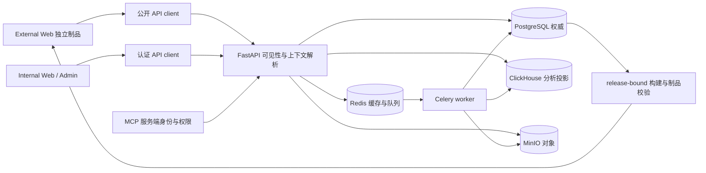

# SoyMutDB 整体完善方案与执行契约

版本：1.0，2026-09-08。用户选择“整体完善方案”，供 PI coding agent 执行。

## 1. 目标与范围

交付一个研究者能准确查数据、管理员能可靠处理数据、实施者能证明隔离正确的数据库产品。完成链路为：选择或发现 assembly/release → 编号搜索 → 筛选分页 → 实体详情 → 序列/变异/表达/JBrowse/下载；内部对应导入 → 校验 → 入库/投影 → release 审核 → 不可变制品 → 发布或回滚。

本轮优先次序：数据正确性和隐私边界 → 真实研究流程 → 导入发布与管理体验 → 性能与维护性 → 全量验收。视觉改进服务这些任务，不挤占数据库入口。保留 React/Vite、AntD、FastAPI、Celery、pnpm/Turbo 和现有存储分工；不整体重写框架。

W0–W7 是本轮必需范围；每项先核实现状，已正确实现的部分复用，只补实际缺口与缺失证据。W8 是独立后续方向。合成 fixture 验证与真实科研数据验收分别记录。

## 2. 当前基线与文档裁决

本次进行了两路项目只读分析和一路官方资料收集，主代理综合设计。此处是静态阅读结论，未运行迁移、服务联调或完整测试。

| 观察 | 依据 | 执行含义 |
| --- | --- | --- |
| pnpm/Turbo 多应用：Web、Admin、JBrowse，API/worker/MCP | 根 AGENTS.md、package.json、架构文档 | 复用模块与 API client，跨消费者收口 |
| `MutantLine.public_id` 已在当前模型出现 | `apps/api/app/models/variant.py:145` | 不照旧 T0 文档再次添加字段；检查签发、发布守卫、迁移与序列化 |
| Gene 已使用 `gene_pk` + `accession`，有 assembly/accession 唯一约束 | `apps/api/app/models/genomic.py:104`、`:163` | 检查旧 Gene.id 消费者与外键，不能仅模型通过就算迁移完成 |
| GeneCrosswalk 已存在 | `apps/api/app/models/genomic.py:258` | 核验引用一致性、provenance、服务与 UI；不另建平行映射表 |
| 双站构建脚本、API client contract 命令已有 | `apps/web/package.json`、`packages/api-client/package.json` | 在已有门禁上增补真实负测 |
| 旧数据库状态描述与模型已不一致 | `docs/dev/database-execution-status.md` 对比以上模型 | 历史“63 passed”等只作历史证据，不等于当前通过 |
| 旧优化总纲含 2026-08-29 的数字和缺口 | `docs/dev/optimization-master-plan.md` | 不把行数、体积、ErrorBoundary 数量或旧 bug 直接当当前事实 |
| 生产验收文件记录历史 No-Go 和真实数据依赖 | `docs/ops/acceptance-current-state.md`，最后记录为 2026-08-23 | W0 刷新现状，不能仅凭旧标记断言已解决或仍未实现 |

指令顺序遵守运行平台。本次明确采用的 AGENTS 约束有效；历史文档中的“已撤销”不是本次用户指令。需求行为以 `database-core-contract.md` 的 normative 条款为准，其“当前基线”日期段落仍须重验。旧设计只作为实现参考；冲突记录到 W0 决策表，不悄悄降低要求。

W0 必须固定实际 checkout/HEAD、脏工作区归属和文件摘要。SMB 工作目录可能与远端原生目录共享文件但不共享有效依赖路径；使用实际可执行环境，不复用文档中的绝对目录、测试库端口或历史虚拟环境作为默认值。迁移编号以当前 Alembic head 分配，不照抄旧文档编号。

本轮抽查 HEAD 为 `6592dfd8e`，存在大量既有未提交修改，因此本方案针对阅读时的工作树，不等同该 commit 的纯净快照。以下代码不一致已由主代理抽查，必须作为首批任务输入：

| 优先任务 | 具体观察 | 首次回归/核验 |
| --- | --- | --- |
| W1.2 | `apps/worker/src/soymutdb_worker/tables.py:73` 的 genes 仍声明字符串 id，缺 gene_pk/accession/assembly_id；`tasks/static_pages.py:339` 已读取 gene_pk/accession | 同步 Core Table 与迁移后的 ORM；真实 PG 执行静态生成及 expression/homolog/cache 关联，捕捉缺列和类型不一致 |
| W1.2/W1.3 | `apps/worker/src/soymutdb_worker/tasks/ingest.py:548` 附近仍用 `_surrogate_id(gene_id)` 建 gene surrogate | 两个 assembly 同 accession 导入后分别引用 PG 正确 gene_pk；查明 CH 字段语义，不能把 hash 当权威 FK |
| W2.1/W2.3 | `apps/api/app/api/v1/search.py:240` 已有内部 RBAC/AuditLog，直接返回模型；函数注释承诺 private/no-store，但函数本身未设置响应头 | 检查全局 middleware 后以真实响应断言 Cache-Control；复用已有端点，补数据范围与多 release 行为 |
| W3.1 | `packages/api-client/src/mutant-lines.ts:3` 仍把 public API 身份定义为数字 PostgreSQL id，详情路径使用该值 | 合法 public_id 的列表→详情正测；内部 ID existing/nonexistent 负测；完整迁移客户端类型与调用方 |
| W3.2 | `apps/web/src/routes/genes/$geneId.tsx:45` 起只校验 assembly URL，getGene/getGeneExpression/getGeneHomologs 仍只传 geneId | v4/v5 同名深链真实请求分离；缓存与 JBrowse 关联链路同版本 |
| W3.2/W3.3 | `apps/web/src/routes/search.tsx:55` 查询键缺 release/assembly/site 上下文；`lib/query-keys.ts:7` 的 gene detail 同样不完整 | 切换上下文和用户后不显示旧结果，query key 工厂及真实 API 回归 |
| W4.3 复用项 | `apps/admin/src/App.tsx:69` 附近已有 RouteErrorBoundary/Suspense，根路由已有 ErrorBoundary | 保留实现，只验缺失覆盖，废弃旧总纲“0 个边界”的待办 |

静态生成的对象键还在 `tasks/static_pages.py:420/436` 使用 `genes/{accession}`，W5 必须核验 bucket/prefix 是否另有 release/assembly 隔离；若没有，修正对象命名空间并以双版本同名 accession 防覆盖测试证明。联邦 HTML 搜索的 `SearchCache.make_key(q, sources)` 不应直接被认定为内外站泄漏：先区分外部搜索来源和 site variant，确认响应究竟依赖哪些上下文，再补真实缺失的 limit/站点/版本维度及测试。

## 3. 硬性约束

下列是实施要求，必须转成测试和门禁。阅读提示词本身不构成隔离。

| ID | 不可违反的约束 | 最低证明 |
| --- | --- | --- |
| C01 | 数据库优先：显著搜索、结构化结果、过滤分页、稳定链接及来源/版本 | 首页到详情的真实接口 E2E；禁止演示统计代替数据 |
| C02 | public_id 稳定唯一、独立签发；不由内部键或实验室编号推导；公开记录发布前非空 | 唯一性、发布拒绝缺号、保留历史公开号与引用测试 |
| C03 | 外站只查询/返回已发布公开记录；内部编号不用于外部定位，也不暴露存在性 | existing/nonexistent internal_id 同类空/404；合法 public_id 正测；响应/URL/下载/浏览器日志/制品负测 |
| C04 | 内部搜索必须服务端授权且限数据范围；登录不等于内部权限 | 匿名、普通用户、内部 A/B 不同范围、撤权后的交叉请求 |
| C05 | assembly 是基因/坐标/别名的命名空间；v4/v5 同名可共存 | 真实 PostgreSQL 唯一约束、关联、导入和查询测试 |
| C06 | release 与 assembly 独立；无版本查询分组或消歧；未知版本不能默认回落 | 两 release 分载 v4/v5；无版本发现；错误上下文负测 |
| C07 | 跨版本关系仅来自显式有证据映射；区分 exact/alias/cross-version/text | 一对一、一对多、多对一、无映射、同名无关系反例 |
| C08 | 搜索、详情、表达、序列、相关变异、JBrowse 全程同一上下文 | 实际网络请求和结果断言，不能仅比较 URL |
| C09 | 缓存/cursor 包含站点、release、assembly、query、filters、排序/分页；内部另含授权范围或禁用 | 相同查询跨站点/用户/版本交替请求；切换上下文拒绝旧 cursor |
| C10 | external/internal 显式构建部署；origin/CORS/制品/SW/cache 分开；内站 private/no-store | 双站构建+访问控制+缓存头+SW 验证；noindex 不能代替鉴权 |
| C11 | PG 权威，CH 为分析投影，MinIO 为对象，Redis 可重建；不得引入生产 SQLite | 数据流/失败重试/投影重建/发布一致性集成测试 |
| C12 | 迁移不破坏身份、引用、历史 release；非可逆的数据操作明确备份恢复条件 | PG 升降级、回填/外键验证；恢复演练及跨 assembly 冲突时明确拒绝降级 |
| C13 | API/OpenAPI 是唯一接口契约，client 正式生成；所有消费者同步 | generate + check:contract、类型检查；Web/Admin/worker/MCP/导出适配 |
| C14 | 保留发布状态机、幂等、审计、不可变制品、陈旧任务保护 | 重复任务/乱序完成/局部失败/回滚不改变错误指针的集成测试 |
| C15 | 沿用 AntD facade/token/i18n；可访问性、空态/错误态、减少动效 | 桌面/平板/移动截图、键盘、缩放、reduced-motion、真实错误恢复 |
| C16 | 不覆盖无关改动，不并发写共享文件，不硬编码成功，不削弱测试换绿灯 | 聚焦 diff；真实命令、退出码和计数；skip/xfail 不满足隐私/身份/assembly 门禁 |
| C17 | Node 24（当前 .nvmrc 24.19.0）、pnpm 11.21.0、Python >=3.14，执行时复核 | 版本与依赖安装状态记录；缺环境列 BLOCKED，不声称通过 |
| C18 | 生产数据/凭证不进 fixture、日志、提示词；运行实例只获必要环境权限 | 测试目标隔离核验；无生产写入、迁移、发布等超范围动作 |

沿用 `../pi-agent-hard-constraints.md` 的 H01–H12，作为 C02–C14 的细化；完整核心交付必须包含 H08 跨版本映射能力，不因其旧矩阵标 P1 而遗漏。对真实映射数据不足，可以验证实现与合成正反例，但真实数据验收仍 BLOCKED。

不得“拒绝所有数字查询”或“突变体一律返回空”冒充隐私完成。公开编号与内部编号可能同字符串的情况下，外站仅按公开编号命名空间解析；不得回落内部键。精确碰撞行为、历史公开 URL 的兼容策略由 W0 冻结，不能开放内部编号到公开号的匿名枚举重定向。

## 4. 技术设计

### 4.1 复用现有分层



这是职责视图，MCP 的实际传输/调用方式以现有实现核验，不要求为画图重写服务。HTTP、内部调用和静态构建入口都必须复用同一可见性规则；不得只在 Web 删字段。

### 4.2 身份与数据模型

- Mutant 保留私有持久化主键；公开 DTO 仅提供 `public_id` 及经审查公开字段，内部 DTO 显式提供 `internal_id`、`public_id` 与获授权的实验室编号。`name` 是否允许公开必须有数据字典依据，不能默认“显示名就不敏感”。
- Gene 复用已出现的 `gene_pk`、`accession`、`assembly_id`；私有外键引用 gene_pk，公开定位用 assembly + accession。检查 transcripts、aliases、variant summaries、expression、homolog、cache、worker、seed loader、CH 投影及历史深链，避免混用字符串 accession 和整数外键。
- Crosswalk 使用现有模型，校验 source/target gene 与其 assembly 一致、relation 类型、来源版本、证据/方法及审核状态。多对多通过多条有证据关系表达，UI 不伪造一对一。基因对应关系不自动等价于坐标 lift-over。
- ID 签发格式、历史回填、实验室编号含义、内部权限范围、真实数据来源/许可不能凭技术偏好替业务拍板。优先查已有批准记录；不足时仅阻塞相关动作，继续 fixture、接口和界面工作。

### 4.3 查询上下文与 API

统一语义上下文包括 `site_variant`、release、assembly、entity type、query、filters、sort、cursor；内部还含经过服务端解析的授权范围。URL 携带用户选择，服务器解析并回传真实上下文；客户端不能凭 active release 猜所有结果的版本。

建议沿用当前路径，W0 冻结准确路由/方法/字段，不新增一套平行 API。公开和内部响应分开 schema 或严格 serializer。新字段使用 audience-explicit 名称，不继续新增含义不明的 `id`。

发现型搜索未指定 assembly 时按可访问 `(release, assembly)` 分组，每项返回自己的上下文与 canonical URL；某 release 不覆盖请求 assembly 时返回明确错误或空结果，不换默认值。详情要求准确上下文；旧歧义深链进入选择界面或明确消歧响应。

结果至少表达实体类型、公开标识、display label、match_type、release、适用的 assembly、provenance 和 canonical URL。`total_count=null` 时不显示假总数；稳定排序含唯一 tie-breaker。cursor 使用现有绑定机制，覆盖 query/filter/sort/site/release/assembly，内部再绑定授权作用域。内部数据先禁共享缓存，确需缓存时记录权限版本/撤权失效策略。

补全、批量查询、导出、MCP、下载预签名、SSG snapshot 均纳入相同可见性清单。授权失败不通过缓存或对象 URL 绕过；公开对象权限和有效期由实际发布策略决定。

### 4.4 导入、投影和发布

复用现有上传/校验/ingest/release 状态机和 jobs-py 契约。导入草稿规整层“不写权威库”是职责分离，不作为 bug。最终 ingest 才校验 identity/assembly/release 并提交权威数据。

PG 事务、outbox、worker 消费与 CH/MinIO 间不假设分布式原子提交。故障恢复沿现有幂等键/状态记录实现；投影失败可重试或重建，数据 readiness 和发布资格必须由权威状态判定。对重复投递、写入半途失败、同任务并发、旧任务晚完成分别测试。

发布复用现有 immutable manifest/digest、lease、publication_id 与 stale-task guard。构建失败不切 active pointer；回滚恢复完整 release/制品引用而非只改首页。真实数据验收先建立来源、checksum、许可证、assembly、样本对应关系和行数/关联检查；合成数据只能证明实现，不证明科研数据有效。

## 5. 信息架构与界面设计

### 5.1 页面结构

| 页面/区域 | 主要任务 | 布局和行为 |
| --- | --- | --- |
| 首页 | 输入编号并到达数据库 | 顶部导航；首屏搜索+实体类型+assembly 选择；release/来源说明；常用数据库入口；新闻置于数据入口之后 |
| 搜索结果 | 理解并缩小命中集合 | 搜索栏保留 query；版本分组；桌面左过滤右结果表；移动过滤抽屉；标签、排序、分页和可分享 URL |
| Mutant 详情 | 引用与关联分析 | 公开编号标题/复制/引用；release/provenance；表型、关联基因/变异、材料相关操作；外站无内部编号 |
| Gene 详情 | 在正确 assembly 阅读与分析 | accession + assembly/version + release；区间/链方向；transcripts、表达、变异、序列、JBrowse；crosswalk 单独标来源与关系 |
| JBrowse | 浏览同版本区间 | 从实体上下文进入；加载中/无轨道/网络失败/版本不匹配可见；返回保留原筛选 |
| 内站搜索 | 按权限查公开/内部编号 | 独立登录及站点标识；明确编号列与匹配字段；不授权则服务端拒绝，清理旧查询缓存 |
| Admin 导入 | 找到问题并恢复 | 文件/映射→预检→错误行处理→ingest 状态→release；操作按钮依据服务端状态，不在 UI 自行推断成功 |
| Admin 发布 | 审核证据并判断是否可发布 | release/数据集/provenance、校验结果、制品摘要、目标与失败原因；显示重试/回滚合法动作 |
| Admin 内容 | 支持数据库说明与帮助 | 复用现有 Page Builder/StaticPage/版本预览，不把内容管理提升为数据库主工作流 |

搜索页设计示意（不是新增路由承诺）：

```text
[SoyMutDB]  数据库  基因组浏览器  分析工具  下载  帮助
[编号或关键词_________________] [实体类型] [assembly: 所有] [搜索]
release: 已选择/按组展示                         数据来源/帮助
过滤条件          命中集合：v4 / release A      [排序]
品种/表型/...     公开标识 | 类型 | 区间 | 匹配类型 | 来源
已选过滤标签      命中集合：v5 / release B
[清除]            公开标识 | 类型 | 区间 | 匹配类型 | 来源
                  [上一页] [下一页]  无准确总数时不展示总页数
```

### 5.2 视觉与状态规则

沿用 `docs/ops/antd6-design-system.md` 及现有 Web/Admin facade、ConfigProvider、token 和 i18n。建议中性背景、清晰表格层级、语义色状态标签；公开标识与坐标可用已有等宽字体。颜色不作为版本/错误的唯一提示。保持现有主题能力，不新增全站视觉框架或大段品牌动画。

所有搜索/列表覆盖 loading、空结果、参数错误、权限不足、网络错误与可恢复重试；版本切换重置分页并取消/忽略旧请求。URL 保存筛选/排序/版本，TanStack Query 保存服务端数据，本地 state 仅存临时交互；不再复制一份服务器结果到全局 store。

验证视口沿用 1440×900、1024×768、390×844。移动端长编号可横向滚动/换行并完整复制，不能截断实际值。键盘可完成搜索、过滤、分页和详情跳转；表单有 label，表头语义正确，焦点可见。遵守既有触控尺寸和 reduced-motion 约束，200% 缩放仍可操作。截图需同时覆盖有数据、空态和错误态；不能用截图替代数据正确性测试。

Admin 错误边界先核验当前实现与覆盖，再补缺失路由/异步错误处理；禁止照旧“0 个 ErrorBoundary”直接重建。内容/设置/导入等大页面只在职责和测试明确后按 feature 拆分，不按行数机械切文件。

## 6. PI 工作分期

默认单实例按依赖推进。用户本次授权了用于制定方案的三个只读子代理，不等于要求 PI 再派三个实施者。若后续明确授权并行，先冻结契约与文件归属；API schema、迁移链、client 生成各自只能有一个写入者。

| 阶段 | 工作与允许改动 | 依赖 | 完成证据 |
| --- | --- | --- | --- |
| W0 现状与契约 | 只读代码/历史 diff；本包状态文档。清点路由、字段、迁移、数据来源、权限、环境和测试；冻结字段/路径/编号碰撞/版本行为 | 无 | 每个任务标“已有且证据有效/已有待验证/真实缺口/输入阻塞”；基线和精确文件归属；不改产品代码 |
| W1 身份与 assembly 收口 | API models/migrations、worker/loader/jobs-py/投影引用及对应测试；复用已有 public_id/gene_pk/crosswalk | W0 | PG 升降级与外键/唯一性，双版本同名基因、旧引用迁移、发布缺号失败、crosswalk 正反例；C02/C05/C07/C11/C12 |
| W2 查询与权限收口 | API routes/services/schemas、安全依赖、缓存/导出/MCP 及测试 | W1；W0 可先写失败场景 | 双 ID 真实查询、内部范围授权、分 assembly/release 搜索、补全与导出负测、cursor/cache 交叉验证；C03/C04/C06/C08/C09 |
| W3 数据库 UI 与调用方 | API client 正式生成；Web 搜索/列表/详情/JBrowse、相关 Admin/MCP 消费者、i18n 与测试 | W2 契约；W0 可先设计交互 | contract/typecheck、真实网络全链路、双站 UI、空错态、响应式截图及键盘验收；C01/C08/C13/C15 |
| W4 导入/发布和 Admin | 导入/发布服务、worker、管理 feature、内容快照与对应测试；仅缺口修复 | W1/W2；UI 联调依赖 W3 | 上传到发布资格、重复/乱序任务、局部失败恢复、过期任务不晋升、回滚与审计；C11/C14 |
| W5 制品/安全门禁 | scripts、e2e、CI、build-sites、SW、必要 deploy/infra 定向修复 | W2/W3/W4；W0 可准备 fixture | 两套真实制品；fixture 确认注入后 external 零泄漏；鉴权、private/no-store、CORS/origin、SW 与下载验证；C03/C10/C18 |
| W6 性能与可维护性 | 受基线证明的数据库索引/查询、bundle/lazy loading、缓存、Admin feature 拆分与守卫 | W3/W4；不得影响 W5 | 相同 fixture/机器/版本下 before/after；查询计划、分页稳定性、bundle 与交互数据；相关根质量门禁 |
| W7 集成与交付 | 状态、验收文档、必要集成修复；staging 方案与已授权隔离运行 | W1–W6 | 全部门禁、真实数据依赖列表、迁移/回滚/health-check 说明；实现/科研数据/部署验收分开；不能带关键跳过项放行 |
| W8 独立后续 | 桌面客户端、本地工具箱、额外物种接入、非核心联邦源扩展 | 本轮完成 + 单独明确范围 | 单独 spike、数据/认证/能力门禁；不占本轮资源，不恢复已移除桌面壳 |

每阶段拆成以下最多三个原子任务，完成一项立即记证据：

- W0.1 环境/diff/调用链清点；W0.2 业务与 API 契约冻结；W0.3 fixture/门禁/缺口登记。
- W1.1 双 ID/发布守卫；W1.2 Gene 及引用迁移；W1.3 crosswalk 与导入/投影一致性。
- W2.1 external/internal DTO 和授权；W2.2 多版本搜索/详情/补全；W2.3 cursor/cache/导出/MCP。
- W3.1 client 生成与迁移；W3.2 搜索/详情上下文；W3.3 UI 状态/可访问性/JBrowse。
- W4.1 导入恢复；W4.2 release/制品状态机；W4.3 Admin 审核/内容预览与错误恢复。
- W5.1 保护值 fixture 和扫描自测；W5.2 双站构建与网络边界；W5.3 E2E/CI 强制接入。
- W6.1 固定数据/负载性能基线；W6.2 只优化最大已证实瓶颈；W6.3 功能/性能回归与维护性核验。
- W7.1 根门禁收口；W7.2 数据/环境与恢复证明；W7.3 可复现交付和剩余输入。

W6 不照旧报告中的体积或性能提升比例设验收。W0/W6.1 固定输入规模、并发、冷暖缓存、运行机器、p50/p95、样本量和误差范围，先签定性能目标，再比较结果；功能正确性/内外隔离不得为加速让步。若无明显瓶颈，交付基线和“不需改动”的理由，不强行重构。

## 7. 验收执行

### 7.1 fixture 与矩阵

至少包含两个 release、v4/v5 同名不同基因、可信与无证据映射、公开/未公开/删除 Mutant、独立双 ID、公开/内部编号碰撞案例、普通用户、内部 A/B 不同范围、带 `%`/`_` 的查询、分页排序同值记录。

覆盖 external/internal × public/internal identifier × v4/v5，并在适用实体层落地；不以“突变体无直接坐标”省略关联 gene/variant 的 assembly 测试。增加发布可见性、鉴权范围、跨 release 维度。每个相关 API 变更至少有一个成功样例和一个能捕捉边界泄漏的负例。

保护值为本次合成 fixture 的实际值，必须证明进入了请求/构建输入。扫描器先能检出故意污染的样例，再扫描真实 external HTML/JSON/manifest/source map/SW 和导出。空目录、未注入的随机 sentinel、仅搜索字段名都不算负测通过。

### 7.2 命令入口

执行前检查当前 package.json/pyproject/脚本帮助；以下是仓库已声明入口，不是本次运行结果。新增测试必须加入相应命令。先窄测试，后根门禁。

```bash
# 仓库根目录
node --version
pnpm --version
python3 --version
git status --short
pnpm --filter @soymutdb/api-client generate:api-client
pnpm --filter @soymutdb/api-client check:contract
pnpm check:page-registry
pnpm check:web-query-keys
pnpm check:admin-content-architecture
python3 -m unittest scripts.test_site_artifact_isolation -v
```

生成 client 之前核验生成脚本数据源，使用本轮权威 API schema；不得连接不明远端实例生成。

```bash
# apps/api；先检查 conftest 的数据库清理行为和隔离目标
.venv/bin/python -m pytest tests/test_search.py tests/test_search_contract.py tests/test_search_database_integration.py tests/test_mutants.py tests/test_genes.py tests/test_migrations.py -q
# 对新迁移、公/内部权限、crosswalk、导入/发布新增或已有测试另列精确路径
```

```bash
# 仓库根目录，窄测试通过后
pnpm lint
pnpm typecheck
pnpm test
pnpm build
pnpm --filter @soymutdb/web build:sites
```

`pnpm build` 不替代双站 build:sites。完整 Python 检查分别在 apps/api 和 apps/worker 使用各自有效 `.venv/bin/python -m pytest tests -q`；jobs-py/MCP 变更补跑其实际测试入口。迁移测试必须用隔离 PostgreSQL。

```bash
# e2e；先列出实际配置/用例，再执行适用真实 API 流程
pnpm exec playwright test --list
pnpm exec playwright test
```

以上默认 Playwright 命令不保证覆盖所有项目。W0 必须检查 e2e 配置并登记 external anonymous、internal authenticated、真实生产式后端及 visual 的准确 config/project/spec 命令。mock/demo 流程不得替代真实 API 流程。

制品扫描命令在构建 fixture 配置确定后运行：

```bash
python3 scripts/check_site_artifact_isolation.py --external-root apps/web/dist/external --internal-root apps/web/dist/internal --sentinel "$UNRELEASED_SENTINEL"
```

UNRELEASED_SENTINEL 必须非空且等于本轮真实注入的合成保护值。生成的证据不要包含真实凭证或私有科研数据。

部署资产有改动时追加实际 Compose config、镜像 runtime smoke、API readiness、静态路由、内部未授权访问和恢复演练；无 Docker 的开发环境可先跑仓库契约测试，但未执行的部署验收仍保留阻断。

### 7.3 完成标准

- 单任务 VERIFIED：实现目标行为 + 正反例通过 + 消费者一致 + 证据绑定当前版本。
- W1–W7 完成：所有适用 C01–C18 与 H01–H12、根质量门禁、双站制品和真实 API 浏览器链路通过。关键场景失败、skip、xfail 或未运行都不算通过。
- 真实科研数据就绪：来源/许可/assembly/样本对应/provenance/质量校验和可复现数据查询证据齐全；合成 fixture 不满足此项。
- 可发布：上述要求与部署/恢复/健康检查通过，并取得明确发布授权。未取得授权时交付“验收状态和发布准备”，不擅自上线。

## 8. 状态、失败与恢复

创建本目录 `execution-status.md`，不得覆写旧数据库历史证据。每个原子任务后、压缩上下文前、阶段结束时更新：

```markdown
# 整体完善执行状态
- 日期/角色/PI 版本/provider/model：
- 原生工作目录/分支/HEAD/相关文件摘要：
- 既有未提交变更与归属：
- 环境和测试目标隔离证据（不含凭证）：
- 冻结契约/业务决定/来源：

| 任务 | 状态 | 精确文件范围 | 依赖/阻碍 | 下一步 |
| --- | --- | --- | --- | --- |
| W0.1 | IN_PROGRESS | | | |

| 约束/场景 | 命令与 cwd | 时间/HEAD/diff 摘要 | 退出码 | pass/fail/skip/xfail | 证据路径/摘要 | 判定 |
| --- | --- | --- | --- | --- | --- | --- |

- 已实现但未验证：
- 历史证据失效项：
- 真实数据/授权/环境依赖：
- 下一条可执行动作：
- 产品实现 / 数据就绪 / 部署验收结论：
```

状态只用 NOT_STARTED、IN_PROGRESS、BLOCKED、IMPLEMENTED_UNVERIFIED、VERIFIED。不适用条目写理由，不伪造通过次数。环境无法启动与断言失败分开记录；同因失败排查根因后再试，不重复刷命令。测试使用非生产库的证明不足时停止数据写入，继续无依赖只读/文档/组件工作。

恢复时先读状态、实际 diff 和证据，再读当前阶段文件；保留已验证且未变化的工作。只重验受影响证据，最终再执行对应集成门禁。交付中列已完成、未实现、未验证、阻塞输入和下一步；不报无依据百分比。
