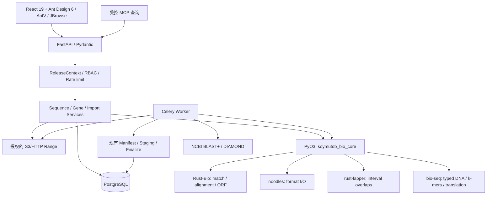

# SoyMutDB Next 0.1.2 — Rust-Bio + noodles + rust-lapper + bio-seq 生物数据内核架构与开发规范

> **入库说明（2026-11-05）：** 本文件原文是 Issue #1 的附件 `SoyMutDB_Rust_Core_Development_Spec_2026-11-05.md`（1023 行），此前未纳入版本库，
> 因此按文件名 `find` 在 `main` 上查不到。此提交仅做原文归档，不改动任何规格内容。
> 文中所有 crate 版本均标注为「参考候选，必须先 `cargo check` 验证」；
> `rust-toolchain.toml` 的 Rust 版本按 §13.2「不预设未验证的编译器版本」要求，由实测确定后另行提交。

> **文档状态：** 设计提案 / 待实施，不代表代码已完成、PR 已合并或 CI 已通过。  
> **基线：** `caoronglin/soymutdb-next`，2026-11-05 读取的 `main`：`d95aff0bf06db3030f8b0e41535ce4108b04cdeb`。  
> **产品理念：** 简约、美观、好用、自主。  
> **更新范围（2026-11-05）：** rust-lapper / bio-seq 正式纳入目标内核；新增区间检索、类型化序列与 k-mer API 设计，以及 CNB/GitHub 镜像一致的 CI/CD、全量测试、冒烟测试、回归测试和发布验收规范。  
> **版本目标：** SoyMutDB 产品发布 `0.1.2`；Rust crate、Python wheel、REST API 和数据库迁移各有独立兼容/版本语义。  
> **重要原则：** 不推倒重来；保留 FastAPI、PostgreSQL、SQLAlchemy、Celery、JBrowse、Ant Design、AntV、完整 BLAST+/DIAMOND 的职责。Rust 负责计算密集型序列处理及部分格式解析。  

## 1. 决策摘要

引入单个共享 Rust 核心 `packages/bio-core`，通过 PyO3/maturin 向现有 Python API 与 Worker 暴露稳定的结构化接口。四个主要依赖各有明确职责：

- **Rust-Bio（必选）**：序列匹配、反向互补、双序列比对、GC 统计和 ORF 相关算法。
- **noodles（必选）**：FASTA/FASTQ/GFF3/GTF/BED/VCF/BCF/BGZF/Tabix/SAM/BAM/CRAM 格式读写与索引操作；分阶段开启格式。
- **rust-lapper（必选，按场景启用）**：经过验证的 0-based 半开区间重叠、计数、交集和注释关联。只在必要场景构建索引，不替代 PostgreSQL 的关系查询或已有 JBrowse 区间索引。
- **bio-seq（必选，按场景启用）**：带明确碱基类型的紧凑序列表示、IUPAC 类型、固定长度 k-mer、DNA 互补和遗传密码翻译。必须与 Rust-Bio 的重叠功能划定单一 owner，不能维护两套不同语义的反向互补实现。

`needletail` / `seq_io` 仅作为 FASTX 基准对照候选。不要为此引入第二套 HTTP 服务、任务队列或客户端 WASM。

新增一个面向用户的 **Sequence Tools / 序列工具箱**，包括短序列精确匹配、近似匹配、反向互补、局部/全局/半全局双序列比对、GC/长度统计、ORF、翻译、CDS 提取、固定长度 k-mer 统计及已发布参考范围内的基因组区间重叠检索；无须调用 BLAST 的轻量序列工具独立于 BLAST 页面，但可将结果关联到 SeqFetch、Gene Center 和 JBrowse。完整 BLAST+ 仍是全基因组、蛋白库相似性搜索的权威执行引擎，DIAMOND 作为可选的高速蛋白搜索。

### 1.1 明确不做

- 不以 Rust 重写 FastAPI/SQLAlchemy/Celery/Redis/PostgreSQL、认证授权和审计。
- 不以 Rust-Bio pairwise alignment 代替 `blastn/blastp/blastx/tblastn/tblastx` 或 DIAMOND。
- 不在当前阶段重写浏览器端的 `packages/genome-data` 与 JBrowse / GMOD IndexedFasta/Tabix/VCF 读取器，不引入不必要的 WASM。
- 不用 noodles 取代已由 HTSlib/cyvcf2 正确实现、尚未证明是瓶颈的 VCF 导入热路径。
- 不添加 Scanpy、单细胞分群或其他复杂生信工作流；保留数据库已有的数据展示能力。
- 不让 AI 执行任意 Rust 函数、任意文件路径或 shell 命令；MCP 保持受控只读数据库查询与已有授权任务边界。

## 2. 当前仓库审计和迁移范围

| 现有代码位置 | 观察到的实现与约束 | Rust 方案 | 决策 |
|---|---|---|---|
| `apps/api/app/services/seqfetch_service.py` | FAI 解析、S3/HTTPS Range、单次区域最大 1 Mb、最多 200 基因、内联 FASTA 10 MiB；release 约束 | 将碱基转换、FAI/序列处理的纯计算部分替换；保留网络、数据库、对象存储职责 | P0/P1，先基准测试 |
| `apps/api/app/schemas/seqfetch.py`、`apps/api/app/api/v1/tools_seqfetch.py` | 已有公开 `/tools/seqfetch`，按基因列表或 assembly+region 提取 | 保持原有 API 输入/输出和限制不变，内部渐进切换 | **禁止破坏性改动** |
| `apps/api/app/services/gene_structure_import_service.py` | Python GFF3 解析与 transcript/CDS/exon 组装，已有业务持久化 | noodles GFF3 逐条解析；Rust-Bio/自有逻辑辅助；Python 保留关联/发布事务 | P1；多 Parent、乱序、phase 必须补测试 |
| `apps/worker/src/soymutdb_worker/tasks/data_adapters.py` | `FastaAdapter`、`Gff3Adapter` 默认 fail-closed，缺少完整持久化 writer/发布登记 | Rust 验证器 + 安全导入 writer + 现有 manifest 协议 | P1；不能只替换 parser 就宣称导入可用 |
| `apps/worker/src/soymutdb_worker/tasks/ingest.py` | 使用 cyvcf2，VCF 导入受 feature flag 和 staging/finalize 约束 | noodles VCF/BCF 做校验/预览候选；cyvcf2 保留生产主路径 | P2，验证后才迁移 |
| `apps/api/app/services/import_inspection_service.py` | 只读文件预览有 256 KiB、100 行、归档体积等限制 | noodles 做 FASTA/GFF3/VCF 等格式预览适配 | P1，保持防御限制 |
| `packages/genome-data/src/readers/{sequence,feature,variant}.ts` | 现有 `@gmod/indexedfasta`、Tabix、VCF 浏览器读取器 | 不替换；Rust 只服务后台预处理 | 保留 |
| `apps/api/app/services/blast_service.py`、`apps/worker/.../blast.py` | BLAST 任务所有权、outbox、数据库隔离；当前 DIAMOND blastp | Rust 用于 FASTA 验证和结果解析候选，**不负责 BLAST 计算** | 保留业务边界 |
| `packages/enrichment-core` | 已有 PyO3/Cargo 实验包，使用另一套版本与依赖 | 技术复用/构建经验借鉴；不直接合并科学职责不同的 crate | 独立保留 |
| `apps/api/app/api/v1/genes.py`、`apps/api/app/models/genomic.py` | 已有 gene/transcript/exon、release/assembly 限定和位置接口 | `rust-lapper` 为**已选定且授权的**小规模注释/区间集合建立重叠索引；数据库发现与权限仍由 Python/SQLAlchemy 执行 | P1，不能扩展为公开全表扫描 |
| `packages/genome-data/src/types.ts` | 浏览器端内部坐标为 0-based half-open | Rust-lapper `start/stop` 严格对齐；API 边界在 1-based inclusive 与半开坐标间转换 | P0 不变量 |
| `packages/jobs-py/src/soymutdb_jobs/protein_fasta.py` | BLAST 提交共享 FASTA 契约 | 可用 `bio-seq` 做 Worker 级 k-mer/翻译工具；BLAST 的 FASTA 合同与服务校验保留现有 owner | 需对照回归 |


权威约束文档：`docs/adr/0005-import-idempotency-and-visibility.md`、`docs/dev/database-core-contract.md`、`docs/architecture/blast-plus-architecture.md`、`docs/architecture/data-provenance.md`。这些文件包含目标态与历史记录；执行前需再次核对当前代码，不可把目标契约误写为已实现。

## 3. 开源组件技术选型

| 开源项目 / 文档 | 主要用途 | 项目角色 | 采用条件 |
|---|---|---|---|
| [rust-bio / bio](https://docs.rs/bio/latest/bio/) | Pattern matching、pairwise、FASTA/FASTQ、GC、ORF、索引算法 | **核心必选** | 当前参考版本 4.2.2；按锁文件固定 |
| [noodles](https://docs.rs/noodles/latest/noodles/) | FASTA/FASTQ、GFF3/GTF、BED、VCF/BCF、SAM/BAM/CRAM、BGZF/Tabix/CSI | **格式处理必选** | 当前参考版本 0.118.0；API 仍被官方视为 experimental，必须锁定并测试 |
| [PyO3](https://pyo3.rs/) | Python 原生扩展与异常、对象转换 | **绑定必选** | 当前参考版本 0.30.1；先评估与已有 PyO3 0.29.3 的工作区兼容 |
| [maturin](https://www.maturin.rs/) | 构建 Python 3.15 wheels | **构建必选** | 当前参考版本 1.16.0；构建矩阵验证 |
| [rust-lapper](https://docs.rs/rust-lapper/latest/rust_lapper/) | 区间重叠、命中计数、覆盖/交集和注释关联 | **核心必选；P1 对应模块** | 当前官方文档 `1.3.0`；限定 0-based `[start, stop)`，先做与 PostgreSQL/纯 Python oracle 的一致性和性能测试 |
| [bio-seq](https://docs.rs/bio-seq/latest/bio_seq/) | 压缩/类型化 DNA、IUPAC、固定 k-mer、密码子翻译 | **核心必选；P1 对应模块** | 当前官方文档 `0.15.2`，翻译启用 `translation` feature；标准密码表 `STANDARD` 已有，其他密码表必须逐项实现并用权威表验证 |
| [needletail](https://docs.rs/needletail/latest/needletail/) | 高速 FASTA/FASTQ、k-mer | P2 对照 | 不默认与 noodles 重复安装，先性能对照 |
| [seq_io](https://docs.rs/seq_io/latest/seq_io/) | 低复制 FASTA/FASTQ 解析 | P2 对照 | 注意其 FASTQ 解析按文档仅支持单行序列格式 |
| [rust-htslib](https://github.com/rust-bio/rust-htslib) | HTSlib Rust 绑定 | 备选 | noodles 不符合功能/性能需求时再选，避免双套 HTS 依赖 |
| [rust-bio-tools](https://github.com/rust-bio/rust-bio-tools) | VCF 对照、FASTQ 操作、VCF/BAM 报告等 CLI | 参考/验证 | 不把整套分析 CLI 默认部署到数据门户 |
| [rayon](https://docs.rs/rayon/latest/rayon/) | 并行 CPU 批处理 | 仅 Worker 可选 | 经基准验证加速，避免 API 内线程过量 |
| [serde](https://docs.rs/serde/latest/serde/) / [thiserror](https://docs.rs/thiserror/latest/thiserror/) | 结构化契约与内部错误 | 核心辅助 | 稳定类型和受控错误输出 |

**四库单一职责表：**

| 科学动作 | 唯一规范 owner | 不重复实现的边界 |
|---|---|---|
| 匹配、近似匹配、pairwise/ORF | Rust-Bio | bio-seq 不额外实现第二套对齐算法 |
| 格式解析、记录迭代、BGZF/索引 | noodles | Rust-Bio FASTA reader 仅用作独立测试 oracle |
| 注释区间重叠/计数/批次求交 | rust-lapper | 不替代数据库索引、JBrowse、关系 JOIN |
| 定长 k-mer / 压缩 DNA / 翻译表 | bio-seq | 模糊碱基策略显式，`STANDARD` 之外不得假设均已内置 |
| FastAPI/任务/持久化/权限 | Python 现有服务 | Rust 不拥有认证、发布流程或 SQL |

> **选型规则：** 先确定一个通用格式主入口（noodles）；Rust-Bio 的 FASTA reader 可作为对照而非第二套生产实现。rust-lapper 和 bio-seq **正式列入依赖设计**，但每项功能是否启用仍需真实正确性与性能门禁。HTSlib/cyvcf2 已是优化过的实现；Rust 化不是默认更快。

## 4. 目标分层架构



**职责边界：** Rust 不接收数据库凭据、不自行查询 SQL、不决定数据可见性、不自行访问未经授权的 URL。Python 层负责释放数据访问授权并下载文件到受信任的临时目录，或只把经校验的 bytes/reader 交给 Rust。Rust 只处理序列、区间和格式。大结果继续走 Celery + 对象存储，不由 FastAPI 一次性读入内存。

### 4.1 建议新增目录

```text
packages/bio-core/
  Cargo.toml
  Cargo.lock
  pyproject.toml
  README.md
  rust-toolchain.toml
  src/
    lib.rs                  # Rust public interface / PyO3 module
    errors.rs               # Rust error codes
    coordinates.rs          # 0-based/1-based boundary conversions
    sequence/
      mod.rs
      alphabet.rs
      reverse_complement.rs
      exact_match.rs
      approximate_match.rs
      pairwise.rs
      statistics.rs
      orf.rs
      translate.rs
      cds.rs
    formats/
      mod.rs
      fasta.rs
      fastq.rs
      gff3.rs
      gtf.rs
      bed.rs
      vcf.rs
      bcf.rs
      alignment.rs
      indices.rs
    intervals/
      overlap.rs           # rust-lapper 查询 / count / covered bases
      cache.rs             # release+assembly+dataset scoped immutable cache
    typed_sequence/
      mod.rs
      kmer.rs              # bio-seq 固定长度 k-mer
      genetic_code.rs      # bio-seq + 显式 NCBI translation table ID
      iupac.rs             # IUPAC/ambiguous base policy
    bindings/
      python.rs
  tests/
    golden/
    property/
    adversarial/
  benches/
    sequence.rs
    fastx.rs
    gff.rs
    intervals.rs
    kmers.rs
    translate.rs
    vcf.rs
  examples/
    python_usage.py
```

同时在 `apps/api/app/services/sequence_tools_service.py` 新建服务整合层；在 `apps/api/app/schemas/sequence_tools.py` 中定义 Pydantic 请求/响应；在 `apps/api/app/api/v1/tools_sequence.py` 注册新端点；在 `apps/web/src/routes/tools/sequence.tsx` 新建工具页，复用 `packages/api-client` 生成类型；批量作业复用既有 Celery Worker。**路径是建议新建位置，并非已存在文件。**

## 5. Rust 生物计算接口设计

以下是 **目标接口签名**，并不是已实现/编译通过的代码。

### 5.1 Rust 核心 API（概念定义）

```rust
pub enum SequenceAlphabet { Dna, Rna, Protein }
pub enum MatchMode { Exact, Approximate { max_edits: u8 } }
pub enum AlignmentMode { Local, Global, SemiGlobal }
pub enum Strand { Forward, Reverse }

pub struct MatchHit {
    pub start0: u64,  // zero-based inclusive
    pub end0: u64,    // zero-based exclusive
    pub strand: Strand,
    pub edits: u32,
}

pub struct AlignmentResult {
    pub score: i64,
    pub query_start0: u64,
    pub query_end0: u64,
    pub target_start0: u64,
    pub target_end0: u64,
    pub cigar: String,
    pub identity: Option<f64>,
}

pub fn reverse_complement(sequence: &[u8], alphabet: SequenceAlphabet) -> Result<Vec<u8>, BioCoreError>;
pub fn match_exact(reference: &[u8], pattern: &[u8], both_strands: bool, limit: usize) -> Result<Vec<MatchHit>, BioCoreError>;
pub fn match_approximate(reference: &[u8], pattern: &[u8], max_edits: u8, limit: usize) -> Result<Vec<MatchHit>, BioCoreError>;
pub fn align_pairwise(query: &[u8], target: &[u8], mode: AlignmentMode, scoring: Scoring) -> Result<AlignmentResult, BioCoreError>;
pub fn sequence_statistics(sequence: &[u8], alphabet: SequenceAlphabet) -> Result<SequenceStatistics, BioCoreError>;
```

### 5.2 Python 扩展暴露面（概念定义）

```python
from soymutdb_bio_core import (
    reverse_complement,
    find_exact_matches,
    find_approximate_matches,
    align_pairwise,
    sequence_statistics,
    find_orfs,
    translate_sequence,
    validate_fastx,
    inspect_gff3,
    inspect_vcf,
)

reverse_complement("ATGCRY", alphabet="dna")  # IUPAC: R<->Y; expected output is RYGCAT
align_pairwise("ACGT", "AACGT", mode="local", match=2, mismatch=-3,
               gap_open=-5, gap_extend=-1)
```

约束：在 Python 中保留显式的函数签名、类型注解和稳定异常类，避免向 Python 返回复杂 Rust 句柄；批量解析采用受控的 batch iterator，**不得一次构建全文件 `list`**；CPU 密集工作在 Rust 内释放 Python GIL，避免逐个碱基/逐行跨越 FFI；错误消息不包含文件系统机密、未授权路径或数据内容。

### 5.3 模式和科学语义

**精确匹配：** 支持正负链、重复位点、重叠匹配、大小写归一化；`N`/IUPAC 模糊符号支持应作为显式参数（默认为文字精确匹配），不能暗中把 `N` 解释成通配符。Rust-Bio 的 KMP/BNDM/Horspool 可按模式长度选用，但算法选择是内核内部细节。

**近似匹配：** 采用 Rust-Bio Myers；编辑距离与匹配率分开返回，不把近似匹配假称为 BLAST 同源性。限制 query 长度、最大 edit distance、目标区间长度、最多返回位点。大量全基因组搜索交给 BLAST+，不允许同步扫描整条大染色体。

**反向互补：** 完整处理 A/C/G/T/U、IUPAC 模糊碱基（R/Y、K/M、B/V、D/H、S/W、N）及大小写策略。DNA/RNA 各自校验 U/T 规则；蛋白不支持该操作。空输入和非法字符返回受控错误。

**双序列比对：** `local`（Smith–Waterman 类）、`global`、`semiglobal` 三模式；affine-gap scoring 显式配置，返回起止位置、CIGAR/操作列表、score、匹配率和原始序列长度。匹配率的分母必须文档化。矩阵评分与简化打分不能混淆；蛋白比对使用独立矩阵策略，未实现前只开放 DNA/RNA 模式。同步执行前限制 `len(query) × len(target)`，避免 O(nm) 消耗。

**统计和 ORF：** 统计长度、GC、AT、N/模糊碱基数、各碱基频率；分母须声明（GC 是否排除 N）；ORF 返回开放阅读框候选而非“已证实基因”，指定正负链、阅读框、起止密码子和最小长度。

**CDS/蛋白翻译：** 不能简单拼接 GFF3 记录然后直接翻译。必须按转录本关联、CDS phase、负链方向、外显子顺序、基因组版本和密码表进行处理；可选独立 `bio-seq` 翻译模块，须测试标准植物核基因组和细胞器密码表。对非 3 整除的 CDS、内部终止、缺失起始密码子显式给出质量警告。

### 5.4 rust-lapper：区间检索、基因注释重叠与合并语义（正式功能）

**官方依据：** [rust-lapper](https://docs.rs/rust-lapper/latest/rust_lapper/) 文档提供 `Interval {start, stop, val}`、`Lapper::new`、`find`、`seek`、`count` 等接口；作者明确指出采用**0-based 半开区间 `[start, stop)`**，对长度差异极大的区间数据并非所有工作负载都保证同样高的查询性能。

**规范用途**：

1. BED/GFF3 导入验证：检测区间与已发布基因、exon、CDS、UTR 等的重叠。
2. Gene Detail：统计某指定 region 命中的 gene/transcript/variant 注释（前提：已有合法来源，不能绕过权限）。
3. 用户提供的少量 BED 区间：与当前已发布 assembly 的某一注释轨道比较，返回 overlap count、overlap_bp、可选命中记录。
4. 导入质控：检测重复区间、交集、覆盖度，**同一 contig 内**进行比较。
5. 结果下载：复用既有 Download / Export Task，长任务不放入 FastAPI 同步事件循环。

**禁止行为**：

- 不用 `rust-lapper` 代替 PostgreSQL 的关系 JOIN、全文搜索或变异事实过滤。
- 不为每个请求重新载入全基因组 GFF3 文件构建几百万区间的索引。
- 不跨染色体、跨物种、跨 assembly 或跨 release 混合索引。
- 不以 `Lapper::count()` 的命中条数充当覆盖碱基数；`count` 是重叠区间数，`covered_bp` 需取区间并集后计算，重复区间会影响未经合并的统计。
- 不对 `start == stop` 的空区间、负坐标、`end < start`、溢出等情形静默纠正。

**目标 Rust 类型（接口设计，需以实际 crate 版本验证并编译）：**

```rust
use rust_lapper::{Interval, Lapper};

pub struct ScopedIntervalIndex {
    pub assembly_key: String,
    pub release_key: String,
    pub ref_name: String,
    pub data_sha256: String,
    pub intervals: Lapper<u64, u64>, // val: published record index, never private ID
}

pub struct IntervalOverlap {
    pub start0: u64,
    pub end0: u64,
    pub overlap_bp: u64,
    pub record_index: u64,
}

pub fn overlap_count(index: &ScopedIntervalIndex, start0: u64, end0: u64)
    -> Result<usize, BioCoreError>;

pub fn find_overlaps(index: &ScopedIntervalIndex, start0: u64, end0: u64, limit: usize)
    -> Result<Vec<IntervalOverlap>, BioCoreError>;
```

**索引生命周期**：先由 Python 在 API/Worker 中依据当前 `ReleaseContext`、授权、assembly 和 track/dataset 校验合法数据；Worker 构建一次不可变索引，持久化时使用经过验证的稳定格式及校验和（`Lapper` 内存结构**不等于**稳定二进制文件格式）。API 可按 `(site_variant, release, assembly, ref_name, data_sha256, format_version)` 做带内存上限的缓存；跨发布版本必须失效，进程重启可安全重建。

**半开区间计算**：`overlap_bp = max(0, min(endA0, endB0) - max(startA0, startB0))`；仅 `overlap_bp > 0` 才有正长度重叠。并排相邻 `[10,20)` 与 `[20,30)` 不重叠。对外需要 1-based inclusive 时返回 `[start0+1, end0]`；原始 BED 坐标在导出时必须保持原规范。

### 5.5 bio-seq：类型化序列、k-mer、密码子翻译（正式功能）

**官方依据：** [bio-seq](https://docs.rs/bio-seq/latest/bio_seq/) 包含 `Seq<Dna>`、`Seq<Iupac>`、`Seq<Amino>`、`.kmers::<K>()`、`.to_revcomp()`；启用 `translation` feature 后提供 `translation::STANDARD` 和可扩展的 `TranslationTable`。**不要声称已覆盖所有 NCBI 遗传密码表。**

**职责划分**：

- `typed_sequence`：对输入明确声明 DNA/RNA/蛋白及 IUPAC 策略；DNA 两位编码不能无损容纳 `N/R/Y` 等模糊碱基，必须使用 IUPAC 表示或显式拒绝。
- `kmers`：序列长度、k 值、窗口总数、跳过/接受模糊碱基规则、canonical k-mer（与反向互补按字典序取较小表示）、count、GC 等结果。`bio-seq` 的 `kmers::<K>()` 是编译期定长接口，动态 `k` 必须采用经验证的有限 dispatch 集合或独立受测算法，不能把运行时 k 错传给 const generic。
- `translation`：标准遗传密码可使用 `STANDARD`；其他 NCBI translation table 由可信映射表显式实现、逐密码子验证，支持自定义 `genetic_code` ID 的前提是后端有完整映射和金标准，不允许偷偷退回标准表。
- 反向互补的**唯一公开服务 API**保持 Rust-Bio owner；`bio-seq` 可作为内部高速表示/基准，不创建第二个同名行为且细节不同的接口。
- CDS：Python 负责数据库查询、转录本/exon/CDS 的 assembly/release 关联；Rust 负责纯计算，需正确处理负链、GFF3 phase、翻译框与起止密码子语义。

**建议设计的 Python 扩展函数：**

```python
from soymutdb_bio_core import (
    overlap_intervals,          # Rust-lapper, returns bounded structured hits
    interval_overlap_count,     # Rust-lapper
    kmer_counts,                # bio-seq, fixed supported k values
    translate_sequence,        # bio-seq translation feature; standardized code ids
    inspect_genetic_code,       # returns only implemented codes and their evidence
)

# All functions above are TARGET signatures, not currently implemented.
```

**科学约束**：

- k-mer 不等同于 BLAST 的同源性统计，不能由 k-mer 计数推断直系同源关系。
- 对包含 `N` 的窗口明确 `ambiguity_policy='skip'|'reject'`；默认为 skip 并返回 `skipped_windows`，不把 `N` 任意编码为 `A`。
- 输出 `k`, `strand_policy`, `canonical`, `total_windows`, `valid_windows`, `skipped_windows`, `distinct_kmers`, `method`, `engine_version`。
- 单个序列和小规模 k-mer 同步；大批量 k-mer 走 Celery，防止暴露无限内存或 CPU 消耗。
- 任何 translation code 必须明确 `genetic_code_id`, `frame`, `stop_policy`, `partial_codon_policy`, `ambiguity_policy`；返回 warning 而非错误补齐 CDS。
- 植物核、叶绿体和线粒体的密码表应按数据来源/NCBI translation table 对应，而不是根据器官名称猜测。

### 5.6 Rust-Python FFI 边界与批量接口

**统一 PyO3 binding 规范：** Python 只传 `bytes`/字符串和有界的 typed records；Rust 不访问未经授权的对象存储，保留 `release`/`assembly` 元数据但不拿到 DB 凭据。大批量区间以列向量或 batch 传递，避免每个命中单独跨 FFI；返回列表不得超过 limit，完整结果通过 Worker 生成对象存储文件。解释器释放 GIL 仅用于不接触 Python 对象的纯 CPU 任务，并保证取消、超时和内存预算可执行；禁止 Rust panic 跨越 FFI。

## 6. noodles 格式处理规范

| 数据格式 | 主要用途 | 首选接口 | 特别约束 |
|---|---|---|---|
| FASTA | 基因组、CDS、蛋白库入库和预览 | noodles-fasta | 多行序列、ID 重复、换行、UTF-8 header、安全边界 |
| FASTQ | 仅文件验证/预览和数据目录管理 | noodles-fastq | 质量值长度必须等于序列长度；不要变成测序分析工作流 |
| GFF3 | gene/transcript/CDS/exon 属性 | noodles-gff | 属性百分号编码、多 Parent、乱序记录、相位、跨 contig |
| GTF | 转录本注释导入候选 | noodles-gtf | gene_id / transcript_id 语义和属性转义独立处理 |
| BED | 区域上传、基因组位置列表、工具输入 | noodles-bed | 0-based half-open，校验 start < end |
| VCF/BCF | 管理员预览和验证、可选高吞吐导入候选 | noodles-vcf/bcf | 规范化、多等位、INFO/FORMAT Number、样本型别；暂不替换 cyvcf2 |
| BGZF/Tabix/CSI | 随机访问、索引校验 | noodles-bgzf/tabix/csi | BGZF 不等于普通 gzip；要求正确索引及同源文件校验 |
| SAM/BAM/CRAM | 文件头、参考信息、区域记录数等预览 | noodles-sam/bam/cram | CRAM 依赖参考，未提供时不能伪称完整解码成功 |

**GFF3 特别整改点：** 当前 `gene_structure_import_service.py` 对相邻排列的 mRNA 及子记录存在假设。Rust 解析器需要基于 ID/Parent 建立明确关联，正确处理同一子记录多个 Parent、乱序输入；对于大文件采用分批缓存 + 临时索引/外排序或受控两阶段扫描，避免整文件保留在内存。对 GFF3 严格区分 sequence-region、phase、strand、Parent 和 `##FASTA` 段。

**noodles 实施策略：** P0 只启用 fasta/fastq/gff/gtf/bed/bgzf；P1 再接入 vcf/bcf/tabix/csi；P2 根据真实需求启用 sam/bam/cram 和可能的 refget/htsget。不要为了“格式全支持”一次打开全部 Cargo feature。

## 7. 公共 REST API 契约（新增建议）

以下路径均假定被现有 `/api/v1` 主路由挂载；实现时必须确认真实路由前缀，并保持 OpenAPI + 生成式 TypeScript Client 一致。**不修改现有 `/api/v1/tools/seqfetch` 输入/输出。**

### 7.1 API 清单

| HTTP | 目标路径 | 功能 | 权限/限制 |
|---|---|---|---|
| `POST` | `/api/v1/tools/sequence/reverse-complement` | DNA/RNA 反向互补 | 公开已发布序列；限流和输入大小限制 |
| `POST` | `/api/v1/tools/sequence/match` | 短序列精确/近似匹配 | inline sequence 或已发布 assembly+region；目标大小和命中数限制 |
| `POST` | `/api/v1/tools/sequence/align` | 双序列 local/global/semiglobal | cell budget 限制；不作为 BLAST |
| `POST` | `/api/v1/tools/sequence/stats` | 长度、GC、碱基组成 | 限制内联大小 |
| `POST` | `/api/v1/tools/sequence/orfs` | ORF 候选检测 | 阅览已公开输入；限制数量 |
| `POST` | `/api/v1/tools/sequence/translate` | 转译 | 明确 genetic_code/frame/stop policy |
| `POST` | `/api/v1/tools/sequence/cds` | 按 transcript/gene 取 CDS | 必须 assembly + release，保留 SeqFetch 风格来源 |
| `POST` | `/api/v1/tools/sequence/batch` | 大量序列处理 | `202 Accepted`，复用既有任务与导出服务 |
| `GET` | `/api/v1/tools/sequence/capabilities` | 支持格式/算法/限制 | 可缓存，返回能力与版本而非内部路径 |
| `POST` | `/api/v1/tools/sequence/kmers` | 定长 k-mer 计数、可选 canonical 归一化 | 有界序列、k 白名单；bio-seq |
| `POST` | `/api/v1/tools/intervals/overlap` | 指定已发布注释集合或有界区间列表的重叠查询 | 必须 assembly+release；授权数据集；rust-lapper |

导入和预览：继续复用 `/api/v1/admin/imports` 现有路由及导入状态契约；新增 Rust 驱动的 format inspection 是内部 service 的实现变更，不另建平行导入 API。File Preview 使用现有文件预览路径扩展，不暴露临时文件系统路径。

### 7.2 数据格式约束

- **Genome URL / UI 表示：** 坐标 `1-based inclusive`，如 `chr1:1000-1200`。
- **Rust 和 `packages/genome-data` 内部区间：** `0-based half-open`，即 `[start0, end0)`。
- **转换规则：** `start0 = start1 - 1`、`end0 = end1`；精确匹配的 `start/end` 对外返回 1-based inclusive。
- **序列匹配链方向：** `+`/`-` 单独返回；回文模式可保留同一位置两个方向，但必须可识别且统计口径明确。
- **每个参考查询：** 必须返回 `assembly`、`release`、`ref_name`、`coordinate_system`、`provenance`。
- **失配边界：** 不使用不同 assembly 的相同染色体名称互相兜底。
- **版本字段：** `engine`, `engine_version` 为操作实现信息，不等于数据 Release。

### 7.3 请求与响应示例（设计示意，非现有接口）

**POST `/api/v1/tools/sequence/reverse-complement`**

```json
{"sequence":"ATGCRY","alphabet":"dna","preserve_case":false}
```

```json
{"sequence":"RYGCAT","alphabet":"dna","length":6,"engine":"rust-bio","request_id":"<server-generated>"}
```

**POST `/api/v1/tools/sequence/match`**

```json
{
  "pattern":"ACGT",
  "target":{"kind":"region","assembly":"GmWm82.a2.v1","region":"chr1:1000-2000"},
  "mode":"exact",
  "both_strands":true,
  "iupac_mode":"literal",
  "max_hits":100
}
```

```json
{
  "matches":[{"ref_name":"chr1","start":1052,"end":1055,"strand":"+","edit_distance":0}],
  "count":1,"limited":false,"coordinate_system":"1-based-inclusive",
  "assembly":"GmWm82.a2.v1","release":"<resolved-release>",
  "method":"exact","engine":"rust-bio"
}
```

若 `target.kind="inline"`，使用 `target.sequence`；输出位置相对于用户提供的 inline 序列。若 `mode="approximate"`，强制提供 `max_edits`（建议 0–3；以压测结果确定最终限额）。接口严禁直接接受任意 S3 URI/HTTP URL/绝对文件路径。

**POST `/api/v1/tools/sequence/align`**

```json
{
  "query":"ACGT",
  "target":"ACGT",
  "alphabet":"dna",
  "mode":"local",
  "scoring":{"match":2,"mismatch":-3,"gap_open":-5,"gap_extend":-1},
  "include_alignment":true
}
```

```json
{
  "mode":"local","score":8,"query_range":{"start":1,"end":4},
  "target_range":{"start":1,"end":4},"cigar":"4M",
  "identity":1.0,"coordinate_system":"1-based-inclusive",
  "engine":"rust-bio"
}
```

> 比对示例使用相同的 4 bp 序列及 +2/-3 的匹配/错配分值，对应 4 个精确匹配、无 gap 的局部比对；真实实现仍须通过算法金标准与 CIGAR/identity 回归测试。

**POST `/api/v1/tools/sequence/stats`**

```json
{"sequence":"ACGTNN","alphabet":"dna","ambiguous_gc_policy":"exclude"}
```

```json
{"length":6,"gc_count":2,"at_count":2,"ambiguous_count":2,"gc_fraction":0.5,"denominator":4}
```

#### POST `/api/v1/tools/sequence/kmers`（新增目标 API）

```json
{
  "sequence": "ACGTACGTNACG",
  "alphabet": "dna",
  "k": 4,
  "canonical": true,
  "ambiguity_policy": "skip",
  "max_items": 1000
}
```

```json
{
  "k": 4,
  "canonical": true,
  "total_windows": 9,
  "valid_windows": 5,
  "skipped_windows": 4,
  "distinct_kmers": 3,
  "items": [
    {"kmer":"ACGT","count":2},
    {"kmer":"CGTA","count":2},
    {"kmer":"GTAC","count":1}
  ],
  "limited": false,
  "engine": "bio-seq",
  "coordinate_system": null
}
```

> 上述示例按 `ACGTACGTNACG` 的全部 9 个 4-mer 窗口计算：其中 4 个包含 N 而跳过，另 5 个有效窗口在 canonical 化后得到 3 种 k-mer。开发必须使用独立金标准验证该计数、canonical/方向判定、重复次数及输入大小。输出若达到 `max_items` 应设置 `limited=true` 并保持稳定排序。短序列示例不意味着允许任意 k；初始支持的 `k` 集合必须由内核能力和压力测试明确发布在 `/capabilities`。

#### POST `/api/v1/tools/intervals/overlap`（新增目标 API）

```json
{
  "assembly": "GmWm82.a2.v1",
  "reference_name": "chr1",
  "regions": [{"start": 100, "end": 200}],
  "coordinate_system": "1-based-inclusive",
  "annotation_type": "gene",
  "mode": "hits",
  "max_hits": 100
}
```

```json
{
  "assembly": "GmWm82.a2.v1",
  "release": "<resolved-published-release>",
  "coordinate_system": "1-based-inclusive",
  "queries": [{
    "query": {"start": 100, "end": 200},
    "overlap_count": 1,
    "hits": [{"public_id": "<released-gene-id>", "start": 150, "end": 170,
               "overlap_bp": 21, "source": "<released-annotation-source>"}],
    "limited": false
  }],
  "engine": "rust-lapper"
}
```

> 其中 `release`、`public_id` 和 `source` 是服务器填充的**示意占位符**，不能作为真实测试数据。服务端根据 `ReleaseContext` 确认已发布的 annotation dataset 和 assembly；禁止客户端直接传入任意文件路径或任意 SQL 表名。`mode='count'` 时可省略 hits；**重复注释记录的命中数与合并覆盖长度是两个不同指标**，如果提供 `covered_bp` 必须明确 union 逻辑。

#### 原有 SeqFetch 与 BLAST 集成约束

`POST /api/v1/tools/seqfetch` 的请求和响应完全保持原契约；需要新功能时以新增路径实现，不强行修改原 Schema。Gene Detail 可以通过受控 `/sequence/translate` 或 `/sequence/kmers` 使用内核；BLAST 所需 FASTA 验证可被复用，但搜索仍由 NCBI BLAST+/DIAMOND 执行。所有生成的可下载科学结果应复用现有 Download/Export 管理和对象存储路径。

### 7.4 HTTP 和错误契约

统一输出 `{ "error": { "code", "message", "request_id", "details"? } }`，或将该结构映射到现有 API 的统一错误格式，不能在系统中新增相互冲突的两套错误规范。

| 状态码 | 语义 |
|---|---|
| `200` | 同步计算成功 |
| `202` | 超过同步阈值，已转为异步作业 |
| `400` / `422` | 无效序列、模式、字符、坐标、参数、scoring |
| `401` / `403` | 授权不足（适用于内部数据和上传资源） |
| `404` | 可见范围内未找到对应 reference/record |
| `409` | release / assembly / index 版本冲突 |
| `413` | 文件/请求体/序列超出上限 |
| `429` | 配额、请求频率或计算预算超额 |
| `503` | 引擎/存储不可用、索引损坏或未就绪 |

超时应使用统一的结构化错误码及 appropriate HTTP 状态，不要把超时转成成功的空匹配结果。

### 7.5 计算配额（初始设计值，待压测校准）

| 类别 | 同步默认 | 约束 |
|---|---|---|
| 反向互补、统计、翻译 | 最大 1 MiB inline | 不接受无界请求 |
| 短序列精确/近似匹配 | pattern ≤ 256 nt；参考区域 ≤ 1 Mb | 整基因组用 BLAST；命中 ≤ 100/1000 |
| 局部双序列比对 | `query_len × target_len ≤ 1e7` | 超限拒绝或交异步，不能阻塞事件循环 |
| ORF | 最大 1 Mb、最多 1000 候选 | 返回截断标识，不能静默丢弃 |
| k-mer | 推荐 inline ≤ 1 MiB；支持的 k 集合必须列在 capabilities | 输出 distinct 最大 1000；按 `(k, canonical, ambiguity)` 独立计数 |
| 区间重叠 | 单请求 1000 个 region；命中上限 1000（拟定） | 只查询单个合法 assembly/ref/release/dataset；索引缓存有内存预算 |
| Sequence batch | 超过同步限制用 Celery | 总文件大小、时间、CPU、并发额外限制 |

以上是建议安全起点，实施时要与既有 SeqFetch `MAX_GENES=200`、`MAX_REGION_BP=1_000_000`、`MAX_INLINE_BYTES=10 MiB` 区分，**不得不经 API 版本升级直接缩小已有接口限额**。

## 8. Pydantic、前端和 API Client 规范

### 8.1 Python Service / Pydantic

Pydantic 使用 discriminated union 校验匹配目标类型：

```python
from typing import Annotated, Literal
from pydantic import BaseModel, Field, StringConstraints

class InlineTarget(BaseModel):
    kind: Literal["inline"]
    sequence: str = Field(min_length=1, max_length=1_048_576)

class RegionTarget(BaseModel):
    kind: Literal["region"]
    assembly: str = Field(min_length=1, max_length=128)
    region: str = Field(min_length=1, max_length=256)

from typing import Union
Target = Annotated[Union[InlineTarget, RegionTarget], Field(discriminator="kind")]

class SequenceMatchRequest(BaseModel):
    pattern: str = Field(min_length=1, max_length=256)
    target: Target
    mode: Literal["exact", "approximate"] = "exact"
    max_edits: int = Field(default=0, ge=0, le=3)
    both_strands: bool = True
    iupac_mode: Literal["literal", "compatible"] = "literal"
    max_hits: int = Field(default=100, ge=1, le=1000)
```

业务 Service 在调用 Rust 前必须完成鉴权、release/assembly 解析、请求体上限、限流、数据来源校验；Rust 再进行独立的安全边界校验。所有长度与坐标在转换时使用 checked arithmetic，拒绝负数、反向区间、整型溢出和空 reference。

### 8.2 前端组件

新增工具箱可用页面：`apps/web/src/routes/tools/sequence.tsx`。以 **Ant Design 6** 的 `Tabs`、`Form`、`Input.TextArea`、`Select`、`Segmented`、`Descriptions`、`Table`、`Alert`、`Spin`、`Empty`、`Button`、`Tooltip`、`Copy` 相关现有行为实现。工具 Tab：**Reverse Complement / Match / Pairwise / ORF / Translate / Statistics / k-mer / Interval Overlap**。

每项结果均包含：输入合法性提示、计算参数、复制序列/结果、导出 FASTA/TSV/JSON（适用时）、数据来源链接、算法名称和版本、运行时长/状态。匹配结果的位点可在拥有已发布基因组参考上下文时跳转 JBrowse；inline 序列没有基因组坐标，禁止伪造可点击的染色体链接。大数据不直接通过 React 渲染完整序列或完整结果列表。

组件资料：
- [Ant Design 6 Components](https://ant.design/components/overview/)
- [Ant Design Form](https://ant.design/components/form/)
- [Ant Design Table](https://ant.design/components/table/)
- [Ant Design Tabs](https://ant.design/components/tabs/)
- [Ant Design Upload](https://ant.design/components/upload/)
- [AntV G2](https://g2.antv.antgroup.com/)
- [JBrowse 2 Embedded Components](https://jbrowse.org/jb2/docs/embedded_components/)

标准数据统计可复用现有 `@soymutdb/charts` 和 AntV G2；局部对齐 CIGAR/碱基高亮使用专用序列对齐视图，不要用柱状图伪装 alignment。工具箱默认中文/英文 i18n、键盘可操作、支持 prefers-reduced-motion，采用项目现有设计 Token。

## 9. Python↔Rust 构建与安装规范

### 9.1 Cargo 依赖候选（示意，必须先 `cargo check` 验证）

```toml
[package]
name = "soymutdb-bio-core"
version = "0.1.2"
edition = "2024"
publish = false

[lib]
name = "soymutdb_bio_core"
crate-type = ["rlib", "cdylib"]

[features]
default = ["basic-formats"]
python = ["dep:pyo3", "pyo3/extension-module"]
basic-formats = ["noodles/fasta", "noodles/fastq", "noodles/gff", "noodles/gtf", "noodles/bed", "noodles/bgzf"]
variant-formats = ["noodles/vcf", "noodles/bcf", "noodles/tabix", "noodles/csi"]
alignment-formats = ["noodles/sam", "noodles/bam", "noodles/cram"]

[dependencies]
bio = "=4.2.2"
noodles = { version = "=0.118.0", default-features = false }
rust-lapper = "=1.3.0"
bio-seq = { version = "=0.15.2", features = ["translation"] }
pyo3 = { version = "=0.30.1", optional = true }
serde = { version = "1", features = ["derive"] }
thiserror = "2"
```

**说明：** 版本是 2026-11-05 官方资料的参考候选：`bio 4.2.2`、`noodles 0.118.0`、`rust-lapper 1.3.0`、`bio-seq 0.15.2`。开发前必须验证这四者及 PyO3 的 Rust MSRV、crate feature、API 相容性、许可证、Cargo.lock 与实际编译结果，并考虑当前 `packages/enrichment-core` 的 PyO3 0.29.3。**此片段是设计草案，不保证未经验证即可编译。** 正式使用时锁定精确解析版本、提交 Cargo.lock，不使用浮动的 `latest`。

### 9.2 Python wheel 构建

```toml
[build-system]
requires = ["maturin==1.16.0"]
build-backend = "maturin"

[project]
name = "soymutdb-bio-core"
version = "0.1.2"
requires-python = ">=3.15"

[tool.maturin]
features = ["python", "basic-formats"]
module-name = "soymutdb_bio_core"
```

先构建兼容目标操作系统的 wheel 并在 API、Worker 镜像中安装；禁止生产容器启动时临时下载 Rust 工具链编译。若 Windows 是维护目标，必须测试 Windows 的 Python ABI 和 MSVC wheel；Linux 的 glibc/manylinux 标签也必须验证。Rust 核心加载失败时，只有存在经过测试的等价 Python 代码路径才能回退；不得悄悄返回成功的空结果。

### 9.3 接入模式

优先单一包：`soymutdb-bio-core` 为 Python 私有编译扩展，FastAPI 和 Worker 共用。部署时可配置 `SOYMUTDB_BIO_ENGINE=python|rust`（建议初期默认 python），以灰度打开具体功能；日志、结果元数据明确标注实际引擎，禁止功能切换改变字段语义或查询可见性。

## 10. 数据库、索引、下载与发布

1. PostgreSQL 是权威业务实体、assembly、release、序列索引注册和任务状态的来源。
2. FASTA、GFF3、VCF、BAI/TBI/CSI/FAI 等原始和衍生文件存放对象存储并记录内容哈希。
3. Rust 只处理经过授权的已发布文件或管理员暂存文件，不自行决定公开状态。
4. 建索引、导入、规范化后形成不可变 artifact，含：`source_sha256`、`assembly_id`、`release_id`、`parser_version`、`normalization_version`、`schema_version`、`parameters_hash`、行数、错误数、创建时间。
5. 继续执行现有 `CREATE → PARSE → STAGE → VERIFY → FINALIZE → PUBLISH` 的 manifest 协议；实际状态机以仓库当前 ADR/代码为准。重试必须幂等。
6. 导入失败不得泄漏部分公开记录；发布遵循既有审核与回滚策略。
7. 大批量序列导出沿用已有对象存储预签名 URL 和下载服务，不能以 Rust 内核引入另一套文件下载 API。
8. 不修改既有数据库迁移历史；新增字段经 Alembic 前向迁移，先 expand 再切换读写，最后安全清理。

## 11. 安全、资源与正确性约束

- 不接受调用者提交的绝对本地路径、任意 HTTP URL 或 S3 object key 让 Rust 自动打开；服务端解析受控 ID 后才传递已授权对象。
- 所有解析器有字节数、记录数、字段长度、嵌套深度（适用时）、内存、超时和错误数限制；恶意压缩流实行解压预算。
- Python/Rust 边界不得直接 panic 到进程；采用 `thiserror` + PyO3 稳定异常 + FastAPI 统一错误码。
- 序列内容不进入普通请求日志；审计记录用户、权限、算法、输入大小和哈希、状态及耗时。
- 处理用户提供的 FASTA/VCF/GFF3 时保证 parser fuzz/性质测试；对边界数据失败关闭。
- API 的 CPU 工作转线程池/原生扩展释放 GIL 或交 Celery，不能长时间阻塞 FastAPI event loop。
- Rust/Bio 数据结构对内使用 0-based half-open；GFF3/VCF 格式语义对外正确保留，在适配层转换。
- 对多物种多 assembly，所有参考上下文必须显式解析；无可核验的跨版本映射时拒绝自动推断。
- 不把 `noodles` 支持读取某格式等同于已具备该格式的持久化导入、索引构建和发布流程。

## 12. 全量测试、单元测试、契约测试、冒烟测试与回归测试规范

> **本章为正式 QA 契约**。这里定义需要新增或执行的测试，不能把设计中的测试案例解释为已经跑通。每次提交必须记录实际测试命令、环境、退出状态、日志/报告、跳过原因和制品哈希。仓库现有 `.cnb.yml` / `scripts/` 有一些门禁，新增 Rust 门禁应**接入这些既有门禁**，不能另造平行的判断体系。

### 12.1 测试分类与发布关系

| 层级 | 测试类型 | 目的 | PR 必需 | 发布必需 |
|---|---|---|---|---|
| T0 | 静态检查：fmt、Clippy、Ruff、ESLint、typecheck、锁文件 | 工程基础合规 | 是 | 是 |
| T1 | Rust 单元测试 | 纯算法正确性、边界、错误类型 | 是 | 是 |
| T2 | Golden/性质测试 | 生物格式、序列、区间与编码科学语义 | 是 | 是 |
| T3 | PyO3 Wheel 测试 | Python ABI、导入、类型、异常、GIL 与内存 | 是 | 是 |
| T4 | Python API 与共享契约测试 | Schema、OpenAPI、错误码、旧 API 兼容 | 是 | 是 |
| T5 | PostgreSQL/MinIO/Worker 集成 | 发布、权限、幂等、真实存储和任务状态 | 是 | 是 |
| T6 | 前端 Vitest / i18n / E2E | 表单、坐标、展示、权限、数据联动 | 是 | 是 |
| T7 | 运行时冒烟 | 真正的容器、进程、端点、数据访问 | 是（有配套受控环境） | 是 |
| T8 | 全量回归 | 原有网站所有核心业务未被破坏 | 触及功能时必需；主合并门禁完整执行 | 是 |
| T9 | 压测、性能基准、内存、稳定性 | 验证引入 Rust 的实际收益及资源预算 | 基准变更时 | 是（改动热点时） |
| T10 | 安全、SBOM、供应链、跨架构安装 | 依赖、wheel 和镜像的可验证交付 | 是 | 是 |

**重要约束**：全量测试不等于只执行新 Rust crate 测试。必须覆盖现有 `apps/api/tests`、`apps/worker/tests`、`packages/jobs-py/tests`、`packages/import-protocol/tests`、所有前端工作区测试、OpenAPI 客户端、站点外/内隔离、数据库迁移、BLAST 和 SeqFetch、下载及发布制品契约。

### 12.2 Rust 单元测试（必须有具体金标准）

| ID | 库/模块 | 场景 | 预期 |
|---|---|---|---|
| RB-001 | Rust-Bio | 精确匹配、重叠匹配、双链、回文 | 不漏报、不重复误计数；方向准确 |
| RB-002 | Rust-Bio | Myers 近似匹配 | edit distance 与 oracle 一致；超限失败 |
| RB-003 | Rust-Bio | local/global/semiglobal + affine gap | 得分、对齐区间和 CIGAR 一致 |
| RB-004 | Rust-Bio | IUPAC 反向互补、RNA、非法字符 | `revcomp(revcomp(x)) == x`（按约定归一化） |
| ND-001 | noodles FASTA | 多行、空记录、重复 ID、超长 header | 错误位置和计数正确 |
| ND-002 | noodles FASTQ | 长度不一致、质量字符、截断 | 严格拒绝错误数据 |
| ND-003 | noodles GFF3 | 多 Parent、乱序、百分号转义、CDS phase | 注释关联无丢失且归属准确 |
| ND-004 | noodles BED/VCF/BCF | 坐标边界、多等位、INFO/FORMAT | 与规范及现有 oracle 一致 |
| RL-001 | rust-lapper | `[10,20)` 和 `[20,30)` | 相邻不重叠 |
| RL-002 | rust-lapper | `[10,20)` 和 `[19,30)` | 交集长度为 1 |
| RL-003 | rust-lapper | `[10,20)` 和 `[10,20)` | 重叠长度为 10 |
| RL-004 | rust-lapper | 重复区间 + count/coverage | count 按记录，coverage 按并集 |
| RL-005 | rust-lapper | 同名 chr 不同 assembly/release | 不能跨命名空间命中 |
| RL-006 | rust-lapper | 任意排序、零长、越界、大区间极端值 | 稳定处理、校验/拒绝非法输入 |
| BS-001 | bio-seq | 2-bit DNA / IUPAC 输入 | 不允许模糊碱基静默信息丢失 |
| BS-002 | bio-seq | `k=1`, `k=len`, `k>len`, 空输入 | 行为文档化，窗口计数正确 |
| BS-003 | bio-seq | overlapping k-mer、canonical | 正反向 canonical 结果一致 |
| BS-004 | bio-seq | 包含 N/R/Y 的 k-mer | reject/skip 策略与跳过窗口数准确 |
| BS-005 | bio-seq | 标准密码表完整 64 codons | 与 NCBI 标准密码表 oracle 一致 |
| BS-006 | bio-seq | 非标准核/细胞器 translation code | 未实现 code 显式拒绝；已实现 code 与金标准一致 |
| BS-007 | bio-seq | 负链 CDS、phase、内部 stop、不足 3 bp | 蛋白结果和 warning 正确 |
| FFI-001 | PyO3 | bytes/str/list 输入、非 ASCII、超长/空输入 | 不崩溃、不 panic、不泄密 |
| FFI-002 | PyO3 | 批量数据及异常传播 | 无部分成功假象，错误码稳定 |
| FFI-003 | PyO3 | 并发及取消 | 可中止/超时，线程安全 |

**区间 oracle 建议**：使用独立纯 Python 区间交集实现作小数据 oracle，避免以相同 Rust 函数反向验证自己。对数据库实际行为还要与 SQL 基线在同一已发布 release/assembly 上交叉对照。

### 12.3 Property-based / Fuzz / 差分测试

- `proptest` 或 `quickcheck`：生成随机合法 IUPAC、随机长度与坐标；验证双重反向互补、坐标转换往返、区间交集的交换性与边界。
- `cargo-fuzz` 或 AFL++：对 FASTA、FASTQ、GFF3、GTF、BED、VCF/BCF/BGZF 解析输入进行 fuzz；禁止 panic、无限循环、无界内存增长。安全性 fuzz 夜间长跑，PR 执行固定 seeds + 回归语料。
- 对 noodles 与 cyvcf2：只在同一合法测试集上比较解析后的 canonical schema，不以原始对象的 debug 字符串判定等价。
- 对 Rust-Bio 与 bio-seq：反向互补/统计重复能力只选一个生产 owner，另一个可作为独立 oracle；只比较相同的 alphabet 与 ambiguity 策略。
- 对 `bio-seq` 翻译：64 个密码子全表校验；另对每个受支持的 NCBI code ID 做完备表测试，缺失/未知 code 必须错误而非 fallback。
- 对区间缓存：使用同一 chromosome 名但不同 site_variant、release、assembly、annotation checksum 的 fixtures 检测跨版本串数据。

### 12.4 Python API + OpenAPI + 客户端契约

- 复用 `apps/api/tests/test_seqfetch.py` 全集，不得改变旧的最大基因数、区间大小、内联 10 MiB 和旧响应结构。
- 新增 `apps/api/tests/test_sequence_tools.py`、`test_interval_overlap.py`、`test_translation.py`（拟定文件名），覆盖成功、边界、失败、授权、limit、no-result、坐标换算、告警。
- 检查 `packages/api-client` 的 `check:contract`，同时对前端 TS 类型及错误码快照回归。**单改 Pydantic 不等于已经完成 API 开发。**
- Testcontainers 或现有 `scripts/with-postgres-service.sh` 必须提供真实 PostgreSQL；只执行 SQLite/mock 路径不能算数据库集成通过。
- 所有返回参考记录的 API 应包含已发布上下文；内部数据调用需鉴权；external `public_id` 公开约束不可破坏。

### 12.5 Worker、对象存储和真实格式集成

使用受控的微型真实数据集，覆盖：

1. FASTA upload → checksum → valid index/metadata → staging → validate → publish → SeqFetch。
2. GFF3 乱序 Parent/多 Parent → transcript/CDS/exon 结构核验 → 公共 Gene Detail。
3. VCF/BCF 检查/预览 → 确认未授权/未发布数据不进入公共索引；VCF 导入原开关未开启则必须保持 fail-closed。
4. rust-lapper index build → 审核后发布 → overlap query → release rollback → cache invalidation。
5. bio-seq gene/CDS translation → 转录本/基因关联 → 结果下载。
6. 大批量任务重复投递、超时、中止、失败重试、幂等 finalize、部分写入恢复。
7. MinIO/S3 校验和、预签名过期、非法路径、跨用户对象访问。
8. Worker 镜像中 wheel 可导入、Rust 代码可调用，Cargo/Rust 工具链无需在运行时存在。

### 12.6 前端自动测试及无障碍

- Vitest：Tabs/表单联动、错误码、本地化、多数据集筛选、loading/empty/success/error、命中去重、k-mer 分页/排序、坐标显示。
- Playwright：从 Gene Detail → Sequence Tools → FASTA/translation → JBrowse 深链；从 BED 区域 → overlap 结果 → gene detail；BLAST 页面原有行为不回归。
- 在 external/internal 两套完整制品上测试敏感数据隔离；所有需要内部权限的功能验证不能靠仅隐藏按钮实现。
- 支持键盘操作、焦点管理、`prefers-reduced-motion`、亮色/暗色、移动端、简体中文与英文；图表仍使用已有 AntV 共享封装。

### 12.7 冒烟测试（Smoke Testing）必须分层执行

复用仓库现有 `scripts/smoke.sh` 的五层入口；**本次是扩充覆盖，不是新建另一个 `smoke-rust.sh` 并绕过主门禁**。

| 现有 profile | 必须证明 | Rust 新增点 | 缺少环境时的处理 |
|---|---|---|---|
| `contracts` | repo workflow、契约、依赖、权限规则 | rust-lapper/bio-seq API 约束和配置守卫 | PR 必须通过 |
| `static` | Web external/internal/Admin 静态资源完整 | Sequence Tools 路由、懒加载、API client、CSP | 构建产物缺失在构建 CI 中为失败 |
| `runtime` | 真实 PostgreSQL+API、发布数据可查 | wheel import、reverse-complement、k-mer、interval overlap、SeqFetch | 发布必需，未启动 DB 不能标 PASS |
| `e2e` | 真实浏览器端到端 | Sequence Tools、Gene/JBrowse、BLAST/Downloads 核心联动 | 发布必需；PR 用 offline artifact E2E |
| `images` | runtime image、实际 CPU 架构、Trivy、SBOM | API/Worker 镜像中 wheel + Rust 功能 smoke | 发布必需，缺 Docker 不能发布 |

示例冒烟输入（仅用合成或已发布 fixture，不能硬编码生产 ID）：

```bash
# 当前仓库已有入口：
bash scripts/smoke.sh --profile contracts
bash scripts/smoke.sh --profile static --static-dir apps/web/dist/external
bash scripts/smoke.sh --profile runtime   # 需真实临时 PostgreSQL 与服务配置
bash scripts/smoke.sh --profile e2e       # 需可用 Playwright 浏览器
bash scripts/smoke.sh --profile images    # 需 Docker daemon
```

新增的 **Python wheel 导入 smoke** 和 **真实算法 smoke** 应集成到 `scripts/verify-backend-tests.sh` 与 `scripts/build-release-image.sh`，例如在 API/Worker 镜像中验证 `import soymutdb_bio_core`、reverse-complement、固定 k-mer、合法区间重叠、非法坐标拒绝；运行前准备已发布合成 fixture。不能仅 `import` 成功就认定科学结果正确。

**失败策略**：`smoke.sh` 已把 `PASSED / FAILED / SKIPPED` 区分；本设计进一步规定：所有在当前分支 PR/Release Gate 中要求的 smoke 层，`SKIPPED` 即门禁不完整，发布需停止。非必需的本地探索允许带原因的跳过，但绝不可在发布报告中写成 PASS。

### 12.8 回归测试（Regression Testing）强制范围

| 原有模块 | 回归检查 | 禁止的破坏 |
|---|---|---|
| SeqFetch | 已有 `test_seqfetch.py` 全套；gene/region 两种模式；FAI/Range；大小限制 | 旧 API 限额、响应、坐标退化 |
| Gene Center | gene/transcript/exon/CDS、release、assembly、gene_pk 与 accession | v4/v5 混淆、内部主键泄漏 |
| Variants | cyvcf2 既有导入/查询/导出；VCF feature flag | 无批准时自动开启导入或改变 genotype 语义 |
| BLAST | DIAMOND 现有 blastp；NCBI BLAST+ 目标差异；job/outbox/idempotency | 误用 pairwise 代替数据库 BLAST；丢失结果/owner |
| Download/Export | 签名 URL、文件校验、权限、异步任务、统计 | 将 URL 颁发误算为下载完成 |
| JBrowse/GMOD | `packages/genome-data` FASTA/VCF/BAM/Tabix、浏览器桥接 | 额外 Rust WASM 导致跨坐标错误 |
| Site Variants | external/internal 构建隔离、公开 ID / 私有 ID | 未发布数据、secret、internal id 泄露 |
| 其他业务 | Search、Phenotype、Homolog、Expression、GWAS、PopGen、Ontology、MCP、Admin | 隐性删除旧功能和旧路由 |
| Pipeline | CNB vs GitHub mirror、SBOM/Trivy、Pages bytes | 两套 job body 不一致、跳过红灯发布 |

回归运行规则：每个 PR 执行受影响模块的完整回归和全局关键契约；`main` 的受保护合并门禁运行全部现有单测及重要集成；每个 Release Candidate 执行**全量功能+真实数据库+完整浏览器+镜像**。修复任意 BUG 时先增加能复现 BUG 的失败用例，再修复并保留该测试。

### 12.9 基准和性能门禁

- 10/100/1000 组有界区间：rust-lapper vs Python oracle vs PostgreSQL 合法已发布区间结果；另测 10 万/100 万 features 的单索引构建、峰值内存、查询 P50/P95、冷热缓存、数据切换、GC/缓存清理。
- 长度固定 k 与动态指定 k：bio-seq k-mer vs Python 独立 oracle；含 N 的密集序列、回文、不同 k、canon 化、短序列和蛋白输入拒绝。
- 翻译：1000/10000/100000 transcripts 的标准/非标准表、负链、多 exon/phase，以及 Python↔Rust 批量转换与内存。
- noodles/HTSlib：VCF 用现有 cyvcf2 做 baseline；需要比对**完整导入与发布时间**，不以单纯 parser microbenchmark 批准迁移。
- FASTA/FAI：本地盘、HTTP Range、S3 分别测，区分 CPU、I/O、端到端网络延迟；禁止把缓存命中伪装为 Rust 算法加速。

替换既有热路径的建议门槛：端到端耗时减少 ≥25% 或峰值内存减少 ≥30%，准确性零回归，且不恶化 P95 或增加不可接受的构建维护成本。若未达标，rust-lapper/bio-seq 仍可作为有明确新功能用途的独立内核模块，但**不得以“更快”为由擅自替换旧路径**。

---

## 13. CI/CD 流程、制品与发布规范（强制）

### 13.1 复用仓库现有“单一执行来源”

仓库最新 `AGENTS.md` 明确规定：

- **`.cnb.yml`** 是权威流水线编排。
- `.github/workflows/ci.yml`、`baseline-validation.yml`、`pages.yml`、`e2e-smoke.yml` 等是受控镜像/专用流程。
- `scripts/ci-job-steps.sh` 是 CI 任务调度与脚本入口，`scripts/test_ci_job_contracts.py` 守卫契约。
- `scripts/verify-backend-tests.sh`、`scripts/verify-frontend-artifacts.sh` 是共享测试入口。
- `scripts/build-release-image.sh` 是镜像构建、运行时冒烟、Trivy、SBOM、导出与校验的统一实现。
- `scripts/release-contract.golden.sh` 负责签名、校验、制品发布；Pages 只从已验证 artifact 发布，**不得重新构建**。
- `scripts/smoke.sh` 是唯一的五层冒烟入口。

**严禁另建一个与 `.cnb.yml` 冲突的独立 `rust.yml` 且在 GitHub 和 CNB 中复制不同的 shell 逻辑。** 扩展方式是新增或修改 `scripts/verify-bio-core.sh`（建议文件名）、`scripts/ci-job-steps.sh` 的共享任务，并由 CNB/GitHub 包装层调用相同脚本。若添加独立 Rust job，必须更新 `scripts/test_ci_job_contracts.py` 的 job inventory，并证明 wheel 后续**原样**被 API/Worker 测试安装，而不是另行重编译不同版本。

### 13.2 工具链、锁定与开发一致性

当前仓库实际 pin：**Node.js 26.13.0、pnpm 12.11.2、Python 3.15**；新增 Rust 版本由 `packages/bio-core/rust-toolchain.toml` 精确固定并与容器和 CI 同步，不预设未验证的编译器版本。需要在 PR 中提供版本核验清单：

```text
.nvmrc / .node-version / package.json / pnpm-lock.yaml
apps/api/pyproject.toml / apps/worker/pyproject.toml / uv locks
packages/bio-core/Cargo.toml / Cargo.lock / rust-toolchain.toml
packages/bio-core/pyproject.toml / maturin wheel tags
.cnb.yml / .cnb/pipelines/* / .github/workflows/*
Dockerfiles / scripts/check-toolchain-pins.py
```

Cargo 使用 `--locked`；pnpm 使用 `--frozen-lockfile`；Python 使用经确认的 uv lock / 有哈希或固定版本的依赖，不允许 CI 临时解析出与发布镜像不同的包。所有架构必须记录具体 platform 和 CPython ABI。**本设计没有声称 PyO3 0.30.1 与 Python 3.15 的所有目标平台已通过编译**，必须通过 wheel 证据建立事实。

### 13.3 建议任务与入口（必须整合，不是孤立 YAML）

```text
Pull Request / main push
  │
  ├── Repository contracts / toolchain pins / dependency audit
  ├── Frontend: pnpm lint / typecheck / Vitest / build / artifact rules
  ├── Rust bio-core: fmt / clippy / unit / golden / wheel / import-smoke
  ├── Python: API + Worker + shared contracts + real PostgreSQL
  ├── Biological formats: FASTA/GFF3/VCF golden + diff tests
  ├── Browser: Playwright offline-artifact E2E / external+internal
  ├── Release images: build → runtime smoke → Trivy → SBOM → archive
  └── Gate: all REQUIRED checks PASS, no mandatory SKIP
        │
        ▼
     Verified artifacts by commit SHA + checksum
        │
        ▼
     Staging deploy and full smoke
        │
        ▼
     Signed release / publish exact artifact / post-deploy smoke
```

新增 Rust 检查脚本至少包含（**以下为设计中的可执行命令，需要在实际环境验证参数和依赖**）：

```bash
#!/usr/bin/env bash
set -euo pipefail

manifest="packages/bio-core/Cargo.toml"
cargo fmt --manifest-path "$manifest" --all -- --check
cargo clippy --manifest-path "$manifest" --all-targets --all-features --locked -- -D warnings
cargo test --manifest-path "$manifest" --all-targets --locked
# Python feature 与 wheel ABI 在下方单独测试，避免 extension-module 链接行为混淆
(
  cd packages/bio-core
  maturin build --release --locked --interpreter python3.15 \
    --out ../../artifacts/wheels
)
# 将上一步构建出的实际 wheel 安装到隔离的 3.15 测试环境，
# 使用该文件完成 Python 单测、API/Worker 合同及运行时 import smoke。
```

不能在 CI 中“只构建 Wheel”而不安装测试；不能在 API/Worker 镜像中下载最新 rust-bio/noodles 并现场编译。wheel 存入具备 SHA-256 的中间制品目录，API/Worker 安装时验证哈希。对 `linux/amd64` 与 `linux/arm64` 需要 native 或真实兼容的交叉平台构建和导入冒烟；Windows 作为被支持目标时必须额外构建 Windows wheel 并实测安装/导入。macOS 只有在正式支持时成为必需矩阵。

### 13.4 CI 工况与触发矩阵

| 触发 | 最低范围 | 发布权限 | 结果要求 |
|---|---|---|---|
| PR | 全局 contracts + Rust fmt/clippy/unit/golden/wheel + Python API/Worker/Postgres + Frontend + offline E2E + 受影响回归 | 无生产凭据 | 所有必需检查 PASS 才能合并 |
| main push | PR 门禁全部复跑 + 完整集成 + 生产构建 + 镜像运行时冒烟和安全扫描 | 有条件的受保护发布阶段 | 形成 commit-bound 验证制品 |
| 定时夜间 | 全量测试、更多 format fixtures、fuzz 短跑、长 benchmark（独立资源预算） | 不允许直接生产发布 | 非绿则通知并阻断下一候选发布 |
| 0.1.2 Release Candidate | 所有格式/ABI/平台/权限/发布/回滚/性能/安全完整矩阵 | 仅受保护发布作业 | 全绿 + 手工审计记录 |
| 紧急修复 | 原有强制契约 + 修复复现用例 + 受影响全量回归 + 镜像/发布烟测 | 受保护 | 不能借紧急标签跳过数据隔离检查 |

PR 与 main 的不同在于大负载和长时间 fuzz/耐久测试是否延后；**不能延后基础正确性、认证隔离、后端真实数据库集成和工作流契约**。基准回退可以阻断新 Rust 热路径切换，而不是阻断与性能无关的文档变更。

### 13.5 release 制品链和发布准入

1. 审核锁文件、许可证、依赖安全漏洞；对 Rust 依赖进行 `cargo audit` / `cargo deny`（安装和命令选项由实际工具版本验证），合并已有 Trivy / SBOM；不要生成重复互相矛盾的扫描报告。
2. `cargo test`、maturin wheel 和真实 Python 3.15 wheel import smoke 使用同一提交与锁文件。
3. `scripts/build-release-image.sh` 将 wheel 装入 API/Worker 镜像并执行实际 Rust 函数、`app.main`、worker registry 的冒烟；验证架构/CPU 架构标签。
4. 生成镜像 SBOM（需能明确包含 native wheel、Rust crate 及源码构建 provenance）；Trivy CRITICAL/HIGH 按现有策略阻断，不得默认忽略。
5. commit SHA、wheel SHA-256、容器 image digest、static artifact digest、依赖锁哈希写入发布 manifest；不能发布与测试 SHA 不一致的镜像。
6. CNB 权威流水线与 GitHub mirror 的脚本路径、工具链版本和检查结果一致；`scripts/test_ci_job_contracts.py` 绿灯。
7. GitHub Pages 只发布 CI 确认的静态树，`scripts/verify-pages-artifact.sh` 证明字节级一致；运行时 API/Worker 镜像有独立部署及回滚步骤，不得用 Pages 成功替代 API 运行健康证明。
8. 发布后只允许健康检查、合成 fixture 或真正授权的公开数据请求；必须确认该发布版本的 Sequence Tools 路由、API、Rust wheel、Worker、SeqFetch/BLAST/Downloads 均正常。

### 13.6 失败、跳过、回滚和历史兼容规则

- **任何必需 Gate 失败或 SKIPPED 都阻断版本发布**。`continue-on-error`、人为跳过测试、`pytest.mark.skip`、空成功响应都不能冒充绿灯。
- 新 Rust 模块发生 panic/FFI 错误：返回结构化错误，停止当前任务，不允许隐式继续使用错误或截断的数据；旧 SeqFetch 仅可切换到具有金标准对照的 Python legacy 路径。
- `SOYMUTDB_BIO_ENGINE=python|rust` 是设计建议；正式配置键须避开当前环境变量 namespace 冲突，且必须有集成测试。灰度过程需记录任务/结果引擎版本。
- 单独激活 Feature Flags：`bio_kmer`、`bio_interval_overlap`、`bio_translate`、`bio_format_inspection`；禁止用一个总开关偷偷改变 VCF 生产导入逻辑。
- 数据库迁移采用 expand → backfill → dual-read/verify（如必要）→ cutover → contract，回退时保留旧列及索引；缓存索引按 release/assembly/checksum 失效。不得重写历史 Alembic migration。
- 发布回滚使用上一批已验证镜像及 wheel 的对应 digest；不可现场重建旧版本。rollback 的 release 指针和对象存储制品必须可核对。
- Rust 库在真实 benchmark 不达门槛时不替换原有热路径；保留已证明确切的新功能，不因此重写全套 Worker。

### 13.7 必交 CI/CD 证据与验收表

每一项提交均包含：

```text
revision_sha
product_version / rust_core_version / lockfile_hashes
rust_toolchain / node / pnpm / python / maturin versions
wheel file + sha256 + CPython tag + platform tag
cargo fmt / clippy / unit / golden / property / fuzz seed reports
maturin build and wheel import smoke
API + worker + database + OpenAPI + frontend + E2E results
smoke layer status: PASS / FAIL / SKIPPED(reason)
external/internal site artifact scan
Trivy / SBOM / dependency review
Docker image digest and publication manifest
performance baseline, improvement or explicit decision to defer
release and rollback evidence
```

**验收定义：** 0.1.2 完成不仅指 Rust 包编译通过，还必须同时证明：新 API 可调用、算法正确、原有数据库发布安全未破坏、用户工具箱可用、安装制品可复现、真实服务/镜像冒烟通过、全量回归绿色、发布可回滚。

## 14. 分阶段实施计划与合并策略

| 阶段 | 工作 | 交付 | 验收 |
|---|---|---|---|
| R0 | 基线审计 + Rust/Python 基准 | 影响清单、基准脚本、金标准 fixtures | 不改变生产行为 |
| R1 | 建立 bio-core、PyO3、maturin、Rust-Bio/noodles/rust-lapper/bio-seq 核心与锁文件 | Rust crate、wheel、共享 CI 脚本 | Python 3.15 + Docker 构建/导入成功，四库版本锁定 |
| R2 | 反向互补、短序列精确/近似匹配、pairwise、统计 API | Sequence Tools API + 测试 | 参数、坐标、限流、两条链正确 |
| R3 | FASTA/FASTQ/GFF3/GTF/BED 解析、流式预览 | 格式适配器和 Admin 预览 | 金标准+坏数据测试+内存边界通过 |
| R4 | SeqFetch 与 CDS/翻译内核切换，正式接入 bio-seq | 双引擎灰度、密码表 oracle、数据来源联动 | 现有 `/tools/seqfetch` 完全兼容，核/细胞器密码表不被误用 |
| R4a | rust-lapper 区间检索及 bio-seq k-mer 工具 | `/tools/intervals/overlap`、`/tools/sequence/kmers`、文档/前端 | 半开区间、命中去重、k-mer/IUPAC、release/assembly 缓存全面通过 |
| R5 | 完成 FASTA/GFF3 导入 Writer、不可变产物/发布 | 现有 manifest 工作流集成 | 幂等、重试、发布隔离完整 |
| R6 | noodles VCF/BCF/Tabix/索引对照 | 可选替换评估报告 | cyvcf2 语义与性能对照；可拒绝替换 |
| R7 | BAM/CRAM 预览、区间查询、下载中心集成 | 可选展示功能 | CRAM 参考安全、权限、资源限制 |
| R8 | 仪表盘、文档、i18n、性能优化、发布 | 版本发布材料 | 全量 CI/灰度/回滚验收 |

每阶段采用独立功能 PR。每个 PR 说明：当前基线 SHA、修改文件、复用/替换决策、可能影响的 release/assembly、性能证据、真实测试日志、风险、回滚方法。严禁将所有阶段合在一个数百文件的巨大 PR。

## 15. 功能验收清单

- [ ] 原有 SeqFetch public API、限制和响应不变。
- [ ] Sequence Tools 页面含反向互补、精确/近似匹配、局部/全局/半全局比对、GC、ORF、翻译。
- [ ] 所有序列函数有明确 alphabet、IUPAC、坐标和错误契约。
- [ ] Pydantic Schema、OpenAPI、TypeScript API client 与 UI 一致。
- [ ] Rust-Bio/noodles/rust-lapper/bio-seq/PyO3/maturin 版本和锁文件可重现。
- [ ] rust-lapper 区间重叠/计数/coverage 正确，release/assembly/染色体数据不混用。
- [ ] bio-seq k-mer 计数与 IUPAC 语义正确，密码表 64-codon oracle 验证通过。
- [ ] Rust 单元/金标准/差分/Fuzz seeds、PyO3 wheel、真实 API/Worker/DB、Browser E2E 均有证据。
- [ ] CNB 权威流水线与 GitHub mirror 采用同一检查脚本，没有跳过任何必需门禁。
- [ ] `scripts/smoke.sh` 五层冒烟结果及全量回归、发布制品 digest、镜像 SBOM/Trivy 完整。
- [ ] FASTA/GFF3 导入真正形成 durable writer 前继续 fail-closed。
- [ ] VCF 生产路径保留 cyvcf2，除非独立对照与回归证明可替换。
- [ ] BLAST+ / DIAMOND、JBrowse、GMOD 前端读取保持职责不变。
- [ ] 资源上限、release/assembly、权限、数据来源和可观测性完整。
- [ ] Docker/Windows/Linux wheel 能构建和启动；完整 CI/回滚通过。
- [ ] 发布说明区分“已实现”“部分实现”“候选实验”和“未实现”。

## 16. 官方资料

- Rust-Bio：https://docs.rs/bio/latest/bio/
- Rust-Bio pattern matching：https://docs.rs/bio/latest/bio/pattern_matching/
- Rust-Bio alignment：https://docs.rs/bio/latest/bio/alignment/pairwise/
- Rust-Bio FASTA IndexedReader：https://docs.rs/bio/latest/bio/io/fasta/
- noodles：https://docs.rs/noodles/latest/noodles/
- PyO3：https://pyo3.rs/
- maturin：https://www.maturin.rs/
- rust-lapper（1.3.0；0-based half-open）：https://docs.rs/rust-lapper/latest/rust_lapper/
- rust-lapper Lapper（find/seek/count）：https://docs.rs/rust-lapper/latest/rust_lapper/struct.Lapper.html
- bio-seq（0.15.2；compact DNA / k-mer / IUPAC）：https://docs.rs/bio-seq/latest/bio_seq/
- bio-seq translation（feature=translation）：https://docs.rs/bio-seq/latest/bio_seq/translation/
- CNB CI/CD 现有项目规范：`docs/ops/ci-cd.md`
- CI 守卫：`scripts/test_ci_job_contracts.py`
- 共享 CI 执行器：`scripts/ci-job-steps.sh`
- 五层冒烟入口：`scripts/smoke.sh`
- GitHub Actions 镜像：`.github/workflows/{ci,baseline-validation,e2e-smoke,pages}.yml`
- needletail：https://docs.rs/needletail/latest/needletail/
- seq_io：https://docs.rs/seq_io/latest/seq_io/
- NCBI BLAST+：https://www.ncbi.nlm.nih.gov/books/NBK279690/
- JBrowse 2：https://jbrowse.org/jb2/docs/
- FastAPI：https://fastapi.tiangolo.com/
- Pydantic：https://docs.pydantic.dev/latest/
- Ant Design 6：https://ant.design/components/overview/
- AntV G2：https://g2.antv.antgroup.com/

**最终决策：** SoyMutDB 0.1.2 使用 **Rust-Bio（序列算法）+ noodles（格式 I/O）+ rust-lapper（区间重叠）+ bio-seq（类型化序列、k-mer、翻译）** 的单一 Rust 内核，以 PyO3/maturin 向现有 Python API/Worker 提供稳定接口。首先完成正确性、兼容性与构建门禁，再有条件替换原有解析热路径；保留成熟的数据库、BLAST、JBrowse/GMOD、Ant Design 和 AntV。**CI/CD 必须基于现有 CNB 主流水线与共享脚本扩展，所有发布前必需测试、冒烟和回归必须完整通过。**
